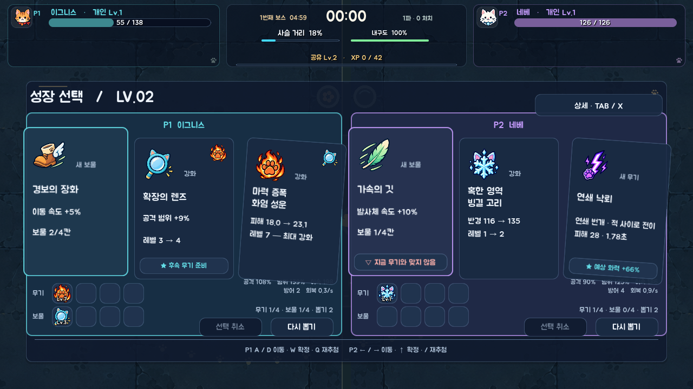

<div align="center">

# 🐾 CO-OP Survivors

**사슬로 묶인 두 고양이가 달빛 든 옥상을 지키는 2인 협동 서바이버라이크**

둘은 떨어질 수 없습니다. 그 사슬이 제약이자 무기입니다.


`Godot 4.7.2` · `GDScript` · 로컬 2인 · 한 판 25분 · 보스 5체

</div>

---

## 목차

| | |
|---|---|
| [빠른 시작](#빠른-시작) · [조작](#조작) | 실행하고 손에 익히기 |
| [사슬](#사슬--이-게임의-전부) · [한 판의 흐름](#한-판의-흐름) · [보스 다섯](#보스-다섯) | 핵심 규칙 |
| [테크트리](#테크트리-기본--보물-강화--공명) · [보물](#보물) · [영구 성장](#클리어-포인트와-영구-성장) · [공명](#공명) | 빌드 만들기 |
| [생존자](#생존자-12명) · [옥상의 불청객](#옥상의-불청객) | 등장하는 것들 |
| [필드 아이템](#필드-아이템) · [옥상](#끝없는-옥상) | 전장 |
| [설계 노트](#설계-노트) · [자동 검증](#자동-검증) | 만든 사람용 |

---

## 빠른 시작

1. [Godot 4.7.2 Standard](https://godotengine.org/download/windows/)로 이 폴더의 `project.godot`을 엽니다.
2. `F5`를 누릅니다.

외부 애드온은 필요하지 않습니다. 효과음과 음악은 파일이 아니라 **실행 중에 합성**되고, 옥상은 로컬 페인팅 타일과 절차적 소품을 조합하며 이펙트는 코드가 그립니다.


---

## 조작

전투 UI는 상단의 반투명 남청색 패널로 구성됩니다. 좌우에는 P1 청록·P2 보라색으로 체력, 개인 레벨, 무기·보물을 표시하고, 중앙에는 시간·사슬 상태·공유 경험치를 모았습니다. 하단은 전투 시야를 위해 비워두며 메뉴·성장·필살기·결과 화면도 같은 테두리와 색상 규칙을 사용합니다.

| | P1 | P2 | 게임패드 |
|---|---|---|---|
| **이동** | `W` `A` `S` `D` | `← ↑ → ↓` | 왼쪽 스틱 |
| **대시** | `Space` | `.` | 오른쪽 트리거 |
| **카드 이동** | `A` / `D` | `←` / `→` | `LB` / `RB` |
| **확정 · 취소** | `W` / `S` | `↑` / `↓` | `A` / `B` |
| **재추첨** | `Q` | `/` | `Y` |
| **상세 보기** | `Tab` | `Tab` | `X` |

공용: `Esc` 일시정지 · `Enter` 재시작 · `F11` 전체 화면 · `F1`~`F4` 화면 흔들림 / 피해 숫자 / 효과음 / 음악.
마우스로도 참가·선택·카드·투표·메뉴를 모두 조작할 수 있습니다(캐릭터 목록은 좌클릭 P1, 우클릭 P2).

디버그 빌드에서는 `F10`으로 런타임 점검 패널을 엽니다. 전투·사슬·각 플레이어의 실제 적용 능력치와 무기/보물/공명 상태를 실시간으로 볼 수 있고, 패널 안의 `F5`~`F9` 단축키로 배속(2 → 5 → 0.15 → 1배 순환), 레벨업, 보물 강화 준비, 완전 회복, 다음 보스를 즉시 점검할 수 있습니다. 패널을 닫으면 배속은 **패널을 열기 전의 값**으로 돌아갑니다. 단축키로 상태를 바꾼 런은 보상과 강화 발견을 저장하지 않으며, 릴리스 빌드에서는 패널이 활성화되지 않습니다.

패널은 화면 오른쪽 절반에 서는데, 거기는 성장 카드·캐릭터 목록·공명 투표가 **P2의 몫으로 쓰는 자리**입니다. 그래서 `F6`·`F7`이 여는 성장 화면을 패널이 그대로 덮으면, 정작 그 단축키가 보여주려던 카드가 가려집니다. 선택 화면이 떠 있는 동안 패널은 화면 맨 아래의 **클릭이 통과하는 띠**로 접혀 지금 어느 화면인지·배속이 얼마인지·마지막 명령이 무엇이었는지만 남기고, 화면을 닫으면 저절로 다시 펼쳐집니다.

> **공격은 자동입니다.** 모든 무기가 가장 가까운 적을 스스로 겨눕니다. 예전에는 이동 방향으로 발사돼서 도망치면 도망치는 쪽으로 쏴야 했는데, 사슬에 묶인 채 조향과 조준을 동시에 요구하는 건 무리였습니다. 부채꼴은 여전히 부채꼴이고 직선은 여전히 직선입니다 — 겨누는 일만 덜어냈습니다.

### 대시

0.18초 동안 3.2배 속도로 돌진하며 **0.26초간 무적**입니다(재사용 1.4초). 돌진 거리는 약 132px, 사슬은 260~500px — **일부러 사슬보다 짧습니다.** 동료 반대 방향으로 대시하면 사슬에 걸려 둘이 함께 끌려갑니다. 도주 수단이 아니라 회피 수단입니다.

다운된 고양이는 대시할 수 없습니다. 구조에서 도망치는 수단이 되면 안 되니까요.

---

## 사슬 — 이 게임의 전부

사슬 길이는 **고른 두 고양이가 정합니다.** 기본 330px에 각 고양이가 가진 `사슬` 값을 더한 것이 그 판의 한계입니다 — 모로처럼 발톱 거리에서 싸우는 고양이는 짧게(−35), 세린처럼 자리를 지키는 고양이는 길게(+85) 만듭니다.

| 조합 | 사슬 |
|---|---:|
| 모로 + 라이라 (최단) | 275px |
| 평균적인 한 쌍 | 약 380px |
| 세린 + 네베 (최장) | 480px |

짧은 사슬은 둘을 한 덩어리로 만들고, 긴 사슬은 전장을 두 배로 넓히는 대신 서로를 못 지키게 합니다. **캐릭터 선택 화면에서 정해지고 그 뒤로는 바닥에 그려진 밧줄의 길이로만 보입니다.**

사슬은 네 단계로 변합니다.

| 상태 | 장력 | 효과 |
|---|---|---|
| 안정 | ~70% | — |
| 저항 | 70%+ | 내구도 회복 정지 |
| **과충전** | 82%+ | **공격력 +25%**, 내구도 소모 |
| 한계 | 95%+ | 내구도 급속 소모 |

즉 **위험하게 떨어져 있을수록 강해집니다.** 내구도를 0까지 태우면 **과부하**가 걸려 공격력이 20% 깎이고, 다시 붙어 있어야 풀립니다.

한 명이 쓰러지면 18초 안에 동료가 105px 이내에서 2.6초를 버텨야 부활합니다. 쓰러진 고양이도 느리게 기어갈 수 있고, 사슬에 끌려오기도 합니다.


---

## 한 판의 흐름

한 판은 **25분**이고, 그 안에 보스가 **다섯 번** 옵니다.

```
0:00 ─── 1:45 ─── 5:00 ─── 10:00 ─── 15:00 ─── 20:00 ─── 25:00 ─► 승리
  │        │        │         │         │         │         │
추격자만  첫 조우   1번째    2번째     3번째     4번째    최종 관제 코어
        (78초마다) 청소로봇  드론모함  옥상관리자 구역통제기
```

- 적은 **30초짜리 파(wave)** 단위로 옵니다. 파가 열릴 때 한 무리가 한꺼번에 쏟아지고, 마지막 **9초는 휴식**입니다.
- **3파마다** 훨씬 큰 대규모 공세가 예고와 함께 들어옵니다.
- 휴식 중에도 엘리트와 보스는 나옵니다. 스웜에서 잠시 벗어나는 시간이지, 안전이 보장된 창이 아닙니다.
- 두 사람에게서 **1500px 넘게** 멀어진 적은 회수됩니다(보스 제외). 회수는 처치가 아니라 경험치도 드랍도 없습니다.
- 난이도 눈금은 62초당 1입니다. 후반 가속 램프는 **248초 이후에만** 작동합니다 — 초반은 이미 가혹한 쪽이라 더 어렵게 만들 이유가 없습니다.

25분짜리 곡선에는 **상한**이 붙어 있습니다. 접촉 피해는 아키타입 기본값의 **2.8배**에서, 이동 속도는 **+34**에서 멈춥니다. 체력은 계속 오릅니다 — 화력도 같이 오르니까요. 원샷만은 어떤 빌드로도 답할 수 없어서 막았습니다. 대신 후반 처치의 경험치가 올라가므로(난이도 1당 +20%) 25분째의 한 마리는 실제로 더 값집니다.

### 이름 붙은 조우

1분 45초부터 **78초마다** 하나씩, 네 가지가 순서대로 돌아옵니다. 오기 전에 이름이 뜨므로 어떻게 설지 정할 시간이 있습니다.

| 조우 | 무엇을 묻는가 |
|---|---|
| **군체 해일** | 벼룩 떼가 두 배로 쏟아집니다. 자리만 잡혀 있으면 공짜 경험치, 아니면 벽 |
| **돌진 폭주** | 경비견 12마리가 **한 방향에서 한 줄로**. 답은 옆으로 비키는 것 — 사슬 때문에 반사가 아니라 합의가 됩니다 |
| **포위 진형** | 16마리가 **틈 없는 원**으로 동시에 나타납니다. 넓게 쓰는 무기와 강화 무기가 존재하는 이유 |
| **정예 편대** | 엘리트 4체 동시 등장 |
| **대범람** | 사방에서 한꺼번에. **7분 이후에만** 나오고, 20분에는 백 마리를 넘깁니다 |


### 몸은 통과하지 않습니다

적은 저마다 가장 가까운 고양이를 향해 자기 직선으로 걸었습니다. 비슷한 방향에서 나온 것들은 그래서 **한 점으로 수렴**했습니다 — 쥐 스무 마리가 쥐 한 마리 크기의 실루엣 안에 겹쳐 서서, 하나로 보이는 형체에서 스무 마리분의 접촉 피해를 냈습니다. 떼로 몰려오는 게 존재 이유인 군체가 가장 심했습니다.

지금은 겹친 몸이 서로 밀어냅니다. 한 번에 완전히 떼어놓지 않고 **여러 틱에 걸쳐 조금씩** 미는데, 빽빽한 무리에서 한 번에 해결하면 서로가 서로의 보정을 취소해 부들부들 떨기 때문입니다. 크기가 밀림의 정도를 정하므로 쥐는 방벽에 튕기고, **보스는 아예 밀리지 않습니다** — 필드에서 위치가 곧 약속인 유일한 존재라서요. 고양이도 한쪽으로만 단단합니다: 적은 고양이 밖으로 밀려나지만 고양이는 절대 밀리지 않습니다. 조작을 뺏기는 순간이 하필 가장 중요한 순간이 되니까요.

그리고 이게 더 큰 무리를 의미 있게 만듭니다. **같은 점에 겹칠 수 있는 이백 마리는 떼가 아니라 더미입니다.** 동시 상한을 420에서 **620**으로 올리고, 파 간격을 더 가파르게(하한 0.16초 → 0.10초), 파 시작 인원과 군체 규모를 런 시간에 따라 자라게 했습니다. 자동 페어 기준 후반 동시 생존 적이 **약 60마리에서 600마리**가 됐습니다.

대신 **초반은 오히려 얇아졌습니다.** 무기가 전부 느려진 만큼 첫 1분은 넓혀야 했습니다 — 첫 파 간격 0.78초 → 1.25초, 셋째 파까지 완만한 구간을 늘렸고, 접촉 피해 초반 감산도 0.75배에서 0.5배로 내렸습니다. 어려워져야 하는 건 중반 이후지 배우는 동안이 아닙니다.

<a id="보스-다섯"></a>

### 보스 다섯

`5:00`부터 **5분마다** 한 대씩 옵니다. 앞선 넷은 관문이지 결승선이 아닙니다 — 쓰러뜨리면 둘 다 체력 절반을 회복하고, 사슬 내구도가 가득 차고, 확정 드랍을 하나 남기고, 판은 계속됩니다.

| # | 시각 | 이름 | 체력 | 접촉 |
|---:|---:|---|---:|---:|
| 1 | 5:00 | 폭주 청소 로봇 | 3,526 | 30 |
| 2 | 10:00 | 경비 드론 모함 | 5,419 | 33 |
| 3 | 15:00 | 옥상 관리자 | 8,280 | 36 |
| 4 | 20:00 | 구역 통제기 | 12,588 | 39 |
| 5 | 25:00 | **최종 관제 코어** | 19,056 | 42 |

랭크당 1.42배입니다 — 두 배가 아닙니다. 보스 사이 5분 동안 페어의 화력이 대략 그만큼 오르므로, 다섯 판이 서로 **비슷한 길이의 싸움**이 되게 맞춘 값입니다. 3번째부터는 격노 문턱이 올라가 대부분의 시간을 돌진 패턴까지 쓰는 상태로 보냅니다.

**둘이 동시에 새 보스와 마주치는 일은 없습니다.** 앞의 보스가 아직 살아 있으면 다음 보스는 대기합니다 — 느린 싸움이 체력 바 두 개로 불어나지 않게.

`최종 관제 코어`를 쓰러뜨리면 승리, 둘이 동시에 다운되거나 출혈 시간이 끝나면 패배입니다.


결과 화면은 공유 레벨과 별도로 **P1·P2 개인 레벨**을 비교합니다. 개인 레벨은 실제로 경험치 결정을 주운 쪽에 누적되며, 각 플레이어의 주운 XP·아이템 수·총 DPS와 현재 무기별 실제 DPS도 함께 남습니다. 협동 기록에는 획득한 필드 아이템을 종류별로 집계합니다.

---

## 테크트리: 기본 → 보물 강화 → 공명

이 게임의 성장은 **세 단계**입니다. 각 단계는 형식이 아니라 진짜 관문입니다.

```
  기본 무기 Lv.7 + 지정 보물 Lv.4 ─► 강화 무기
  P1 강화 무기 + P2 강화 무기 ─────► 공명
```

무기+무기 합성은 없습니다. 각 기본 무기는 **무기 레벨 7 + 지정 보물 레벨 4**를 갖추면 강화되고, 무기 칸과 보물은 그대로 유지됩니다. 강화는 단순한 수치 상승이 아니라 공격 방식을 바꿉니다.

강화 결과 이름은 이 문서에도 적지 않습니다. 조건이 가까워지면 카드의 작은 문장만 반응하고, 실제로 한 번 완성한 결과만 이후 런부터 이름과 전용 아이콘으로 기록됩니다.

> **선택 화면은 이걸 알려주지 않습니다.** 첫 보물 강화는 발견하라고 있는 것이고, 공명은 "우리가 이걸 향해 쌓았구나"를 깨닫는 순간이어야 합니다.


### 보물 강화는 카드 위에서만 귀띔합니다

레벨업 화면 아래에는 두 생존자의 강화 조건이 **표로** 깔려 있었습니다 — `화염 성운 T1/7 + 확장의 렌즈 T0/4 → 초신성`. 레벨 1부터, 매 레벨. 그건 발견이 아니라 심부름이고, 트리의 후반부를 첫 판부터 통째로 넘겨주는 일입니다.

지금은 **카드 옆의 작은 문장(紋章)** 하나가 대신합니다. 두 갈매기가 마름모로 모이는 모양이고, 두 가지 상태만 말합니다.

| 문장 | 뜻 |
|---|---|
| 흐린 회색 | 이 카드가 보물 강화 경로에 있습니다 |
| 진한 금색 | **이걸 고르면 바로 무기를 강화할 수 있습니다** |



어떤 무기로 강화되는지는 끝까지 말하지 않습니다. `Tab` 상세 창도 진행 중인 무기·보물과 `???`만 보여주며, 완성한 결과만 영구 발견 기록에서 해금됩니다.

### 추천은 없을 수도, 여러 개일 수도 있습니다

예전에는 별이 **항상 정확히 하나** 붙었습니다. 셋이 도토리 키재기일 때도 "정답이 있다"고 우기고, 셋 다 시원찮을 때도 그중 제일 나은 걸 좋은 카드인 양 내밀었습니다.

지금은 카드가 절대 기준(42점)과 상대 기준(최고점의 80%)을 **둘 다** 넘겨야 별을 받습니다. 그래서 별이 하나도 없는 판도, 둘 붙는 판도 나옵니다. 반대쪽도 생겼습니다 — 이 빌드에 아무것도 해주지 못하는 카드는 **▽ 비추천**으로 이유와 함께 표시됩니다(`지금 무기와 맞지 않음`, `지금은 효과 없음`). 다만 **한 판이 통째로 비추천이 되는 일은 없습니다.** 셋 다 나쁠 때 필요한 건 절망이 아니라 "그중 뭐가 덜 나쁜가"입니다.

레벨업 카드는 다섯 종류입니다 — **무기 강화 · 새 무기 · 새 보물 · 보물 강화 · 무기 진화**. 무기와 보물을 완성해 최종 무기로 바꾸는 선택은 보물 자체의 레벨업과 섞이지 않도록 **무기 진화**로 따로 표시합니다. 기본 3장 중 **최소 1장은 무기 강화**가 보장되고, 진화 조건이 갖춰지면 해당 카드가 **무조건** 나옵니다. 행운으로 네 번째 카드가 열리면 카드는 서로 겹치는 부채꼴 대신 2×2 비교 그리드로 바뀝니다.

### 무기마다 고유 강화 두 개

무기 강화에는 공용 두 장(`마력 증폭` 피해 +20%, `고속 시전` 쿨다운 −7%)과 **그 무기에만 있는 두 장**이 있습니다. 시작 피해는 카탈로그 기준의 90%로 낮아 초반에는 압박을 받고, 피해 강화는 장당 20%로 커져 중반 관문을 넘긴 빌드는 후반에 급격히 폭발합니다.

| 무기 | 고유 강화 |
|---|---|
| 추적 성탄 | 다중 유도(동시 발사 +1) · 마력 추진(탄속 +46) |
| 연쇄 낙뢰 | 연쇄 전도(연쇄 +1) · 확장 도체(첫 타격 사거리 +36) |
| 화염 성운 | 불씨 범람(화염탄 +1) · 열풍 추진(탄속 +36) |
| 빙결 고리 | 혹한 영역(반경 +19) · 동상(감속 강화) |
| 월식 낫 | 긴 자루(사거리 +19) · 보름베기(각도 +10°) |
| 결속 파동 | 넓은 파동(폭 +9) · **느슨한 족쇄(사슬 한계 +30)** |
| 궤도 파편 | 파편 증식(파편 +1) · 확장 궤도(반경 +14) |
| 관통 광선 | 장사정(사거리 +58) · **분광(광선 +1)** |
| 지뢰 결계 | 다중 매설(매설 +1) · 광역 결계(폭발 반경 +14) |
| 중력 붕괴 | 사건 확대(붕괴 반경 +22) · 강한 인력(인력·사거리 증가) |

**궤도 파편 · 관통 광선 · 지뢰 결계 · 중력 붕괴에는 원래 고유 강화가 하나도 없었습니다.** 로스터 절반이 한 판 내내 피해와 쿨다운 두 장만 받을 수 있었다는 뜻입니다.

### 초반 약화, 후반 가속

숫자가 전부 한 번 내려갔습니다. 가장 크게 느껴지는 건 **연사**입니다 — 모든 무기의 쿨다운이 약 22% 늘었고, 사거리·반경·각도 같은 "화면을 얼마나 덮는가"는 약 12% 줄었습니다. 한 방 자체는 조금 커졌으므로 초당 피해는 5~15%만 떨어지지만, **발사가 눈에 띄게 느려집니다.**

진짜 하향은 강화 쪽입니다. 한 판은 마흔 번 넘게 고르므로 장당 수치는 자기 자신에 몇십 번 곱해집니다 — 다섯 분짜리 런에 열두 번 고르던 시절 값을 그대로 두면 페어가 어느 순간부터 **질 수 없는 상태**가 됩니다. 장당 대략 3분의 1씩 깎았고, 폭주를 허용하던 두 바닥값(신속 하한 0.4 → 0.6, 발동 간격 하한 0.12 → 0.25초)을 올렸습니다.

| | 이전 | 지금 |
|---|---:|---:|
| 시작 무기 피해 | ×1.00 | ×0.90 |
| 마력 증폭(피해) | ×1.16 | ×1.20 |
| 고속 시전(쿨다운) | ×0.88 | ×0.93 |
| 격노의 인장(공격력) | +15% | +9% |
| 질풍의 태엽(발동) | −10% | −6% |
| 처형자의 표식(치명) | +8% | +5% |
| 확장의 렌즈(범위) | +15% | +9% |

로스터 예산은 상대 공정성만 재는 값이라 그대로입니다 — 열두 마리가 서로 공평한지를 묻지, 게임이 쉬운지를 묻지 않습니다. 다만 기준값이 뒤에 남겨지면 열두 마리 전부가 예산 미달로 읽히므로, `survivor_balance_test`가 그 기준값이 여전히 로스터 실측 평균을 따라가는지 검사합니다.

세 무기는 발동 방식 자체를 고쳤습니다.

- **중력 붕괴**는 시전자 발밑이 아니라 **사거리 안에서 가장 가까운 적**을 중심으로 무너집니다. 예전에는 이미 붙어버린 뒤에야 쓸모가 있었고, 그때 하는 일이 하필 **적을 자기 몸 위로 한 덩어리로 끌어모으는 것**이었습니다. 지금은 도착하기 전에 대열을 부수는 도구입니다.
- **결속 파동**은 사슬이 팽팽할수록 세게 때립니다(최대 +60%). 그래서 `느슨한 족쇄`는 자유를 주는 동시에 화력 강화이고, 이 무기가 과충전 메커니즘과 같은 편에 섭니다.
- **관통 광선**은 `분광`으로 굵어지는 대신 **나란한 광선으로 갈라집니다.** 줄무늬가 두꺼워지는 게 아니라 전선을 덮습니다.
- **궤도 파편**은 이제 **파편 하나하나가 따로 때립니다.** 예전에는 링 전체를 초당 다섯 번 검사하면서 한 적은 검사당 한 번만 맞을 수 있었습니다. 즉 첫 파편 말고는 전부 장식이었고, 링 안에 서 있는 보스는 파편이 셋이든 여섯이든 똑같이 맞았습니다 — 이 무기의 간판 강화인 `파편 증식`이 단일 대상에게 **아무 효과도 없었다는 뜻**입니다. 지금은 파편마다 자기 재타격 간격(0.45초)을 들고 매 프레임 판정하므로, 3파편 10회 → 6파편 19회로 파편 수가 곧 화력이 됩니다.

경험치와 레벨은 공유하지만 카드는 각자 고릅니다. 마우스 클릭은 카드를 가리키기만 하고, 각 영역의 큰 **선택 확정** 버튼을 눌러야 잠깁니다. 헤더는 언제나 **P1 선택 중 / P2 확정 완료** 상태를 보여주며, 선택 중인 카드가 강화할 장비 슬롯에는 **1→2**, 새 장비가 들어갈 빈칸에는 **신규** 미리보기가 함께 뜹니다. 확정한 뒤에도 **상대가 아직 고르지 않았다면 취소**할 수 있고, 둘 다 확정한 순간에만 실제로 적용됩니다. 재추첨은 각자 2회로 시작해 3레벨마다 1회씩 보충됩니다(최대 3회).

---

## 보물

능력치는 예전에 레벨업마다 자유롭게 고르는 카드 열두 장이었고, 전부 무제한으로 쌓였습니다. 그래서 빌드란 **그저 뜬 것의 기록**일 뿐 선택이 아니었습니다.

지금은 **27종 중 생존자당 4개까지만** 지니고, 지닌 것만 **레벨 6**까지 올립니다. 칸이 차면 새 보물 카드는 풀에서 빠집니다.

| 개인 | 공유(개인 칸을 쓰지만 팀 전체에 적용) |
|---|---|
| 격노의 인장 · 확장의 렌즈 · 분열의 화살통 · 질풍의 태엽 · 가속의 깃 · **달빛 모래시계** · 수호의 갑주 · 재생의 성수 · 경보의 장화 · 생명의 결정 · 처형자의 표식 · 관통의 송곳 · 가시의 견장 · 불굴의 부적 · 행운의 앞발 · 아홉 목숨 리본 | 인력의 나침반 · 성장의 서 · 행운의 주사위 · **뒤집힌 방울** · 과충전 코어 · 탐욕의 저울 · 별빛 캣닢 · 사냥꾼 방울 · 쌍둥이 부적 · 질주 발톱 |

개인 칸을 내주고 팀 자원을 올리는 것이 공유 보물의 거래입니다. 달빛 모래시계는 투사체·장판 지속시간을 레벨당 10% 늘립니다. 뒤집힌 방울의 **저주**는 적 능력을 8%, 출현을 6% 늘리는 대신 경험치도 6% 늘려, 강해진 빌드가 더 큰 위험과 성장을 함께 선택하게 합니다.

---

## 클리어 포인트와 영구 성장

최종 보스까지 쓰러뜨리면 결과 화면에서 **달빛 생선 8개**를 받습니다. 좌우로 항목을 고르고 `Space`(패드 `Y`)로 구입하며, 효과는 다음 원정부터 적용됩니다. 가격은 현재 레벨만큼 오르고 모든 항목에 상한이 있어 영구 성장이 런 빌드를 대신하지 않습니다.

| 성장 | 1레벨 효과 | 상한 |
|---|---:|---:|
| 튼튼한 심장 | 최대 체력 +3% | 8 |
| 날카로운 발톱 | 피해량 +2% | 8 |
| 빠른 수염 | 발동 간격 −1.5% | 8 |
| 가벼운 발걸음 | 이동 속도 +1.5% | 8 |
| 별빛 주머니 | 자력 +4% | 6 |
| 행운의 꼬리 | 행운 +1 | 4 |

포인트, 성장 레벨, 이미 완성한 보물 강화의 발견 상태는 `user://moonroof_progression.cfg`에 함께 저장됩니다. 테스트용 승리 호출이나 중도 종료는 보상을 주지 않으며 실제 보스 5체 클리어만 인정합니다.

---

## 공명

**강화 무기끼리만** 이뤄지는 최종 단계입니다. 두 사람이 각자 보물 강화를 끝내야 후보가 뜨고, **같은 후보에 투표**해야 활성화됩니다. 한 런에 최대 3개, 각자 자기 쿨다운으로 발동합니다.


투표 화면은 **서로의 커서가 실시간으로 보입니다**(○ 보는 중 / ● 확정). 확정은 취소할 수 있고, 선택이 갈리면 커서는 그대로 둔 채 잠금만 풉니다 — 의견 차이는 실패가 아니라 대화입니다.

강화 무기 12종의 **78가지 짝(동일 조합 포함) 전부**가 최소 하나의 공명을 갖는다는 것을 `tests/resonance_coverage_test.gd`가 쌍별로 검사합니다. 보물 강화를 둘 다 끝내고 "우리 조합은 공명이 없네"가 되는 일은 없습니다.

---

## 생존자 12명


로스터는 예전에 **체력 92~115, 이속 205~242**가 전부였습니다. 25%와 18% 차이는 선택이 아니라 반올림 오차입니다. 지금은 체력·이속뿐 아니라 **위력, 범위, 발동 속도, 재생, 탄속, 추가 발사, 관통, 회피, 반사, 구조력**까지 캐릭터의 시작 능력으로 나뉩니다.

| 고양이 | 무기 | 체력 | 이속 | 위력 | 공속 | 범위 | 재생 | 특징 |
|---|---|---:|---:|---:|---:|---:|---:|---|
| 라이라 | 추적 성탄 | 89 | 288 | 112% | 111% | 86% | 0.0 | 치명 30%·회피 6% |
| 볼타 | 연쇄 낙뢰 | 112 | 262 | 100% | 104% | 108% | 0.2 | 균형형 연쇄 제어 |
| 이그니스 | 화염 성운 | 138 | 198 | 108% | 93% | 112% | 0.3 | 넓은 화염 살포 |
| 네베 | 빙결 고리 | 126 | 186 | 90% | 91% | 125% | 0.9 | 방어 4·상시 오라 |
| 모로 | 월식 낫 | 104 | 262 | 116% | 109% | 90% | 0.1 | 근접 치명·회피 |
| 세린 | 결속 파동 | 156 | 152 | 88% | 93% | 100% | 1.3 | 반사·구조·긴 사슬 |
| 카일 | 궤도 파편 | 129 | 214 | 94% | 109% | 112% | 0.3 | 시작 추가 발사 +1 |
| 리안 | 관통 광선 | 95 | 274 | 110% | 100% | 82% | 0.0 | 관통 +1·고속 탄환 |
| 테라 | 지뢰 결계 | 137 | 190 | 98% | 91% | 116% | 0.7 | 방어·구조·영구 지뢰 |
| 노바 | 중력 붕괴 | 127 | 240 | 100% | 95% | 120% | 0.2 | 적 군집 흡인 |
| 에코 | 생선 부메랑 | 101 | 255 | 106% | 102% | 95% | 0.1 | 세 번 지나가는 투사체 |
| 라떼 | 연유 흩뿌리기 | 121 | 190 | 96% | 96% | 112% | 0.7 | 지속 장판·감속 |

체력은 약 **1.75배**, 이속은 **1.9배** 벌어집니다. 라이라는 최고 속도와 최고 치명률을 가진 대신 로스터에서 가장 얇고, 세린은 가장 높은 체력과 가장 느린 이동 속도를 가집니다. **자력은 더 이상 시작 무기나 캐릭터의 숨은 예산이 아닙니다.** 모든 캐릭터가 같은 100%에서 시작하고, 보물과 영구 성장으로만 올립니다. **사슬**은 위에서 본 그 밧줄 길이입니다.

무기는 생존자당 **4칸**입니다. 시작 무기 하나로 출발해 `신규 기술` 카드로 다른 고양이의 무기를 습득할 수 있습니다. 교체는 없고 추가만 됩니다. 습득한 무기는 원래 주인의 색과 태그를 그대로 가져오고, 각자 독립된 쿨다운으로 발동합니다.

### 선택 화면은 역할만 보여줍니다

고양이는 **품종 한 줄로 소개됩니다** — `별을 쫓는 러시안블루`, `우유를 나르는 노르웨이숲`. 초기 열 마리는 무기 설명으로, 뒤에 합류한 두 마리는 품종으로 소개되던 불일치를 없애 모두 같은 문법으로 맞췄습니다. 무기가 무엇을 하는지는 카드 아래 블록과 레벨업 카드가 계속 말해줍니다.

쉬움/보통/어려움 등급은 제거했습니다. 대신 시작 무기 아이콘, 8개 핵심 수치, 투사체 속도·사슬·회피와 실제 공격 주기를 한 카드에서 비교합니다. 아래 조합 문구는 두 캐릭터의 커버리지와 내구를 계산해 협동 시 주의점만 알려주며, 보물 강화·공명은 미리 노출하지 않습니다.

---

## 옥상의 불청객


| 적 | 성격 | 등장 |
|---|---|---|
| **간식 도둑 쥐** | 가장 가까운 고양이를 추적 | 0:00 |
| **성난 경비견** | 주기적으로 고속 돌진 | 0:30 |
| **옥상 까마귀** | 거리를 유지하며 투척 | 0:36 |
| **벼룩 떼** | 체력 10 · 속도 128 — 22초마다 **7마리 이상이 한꺼번에**. 체력당 경험치가 쥐의 두 배라 파밍 구간이 됩니다 | 0:45 |
| **꼬리 도둑 너구리** | 고양이가 아니라 **사슬**을 뜯습니다 | 0:55 |
| **철통 너구리** | 체력 190 · 속도 44 — 빨리 죽지 않고 그동안 사슬로 곧장 걸어옵니다. 화력을 쓸지 피할지 고르게 만듭니다 | 1:15 |
| **청소 로봇 계열** | 보스 5체. 사슬에서 가장 가까운 지점을 노리는 **사슬 강타**로 내구도를 직접 태웁니다. 격노하면 빨라지고 돌진까지 씁니다 | 5:00부터 5분마다 |

보스의 원형 강타는 **1.5초 예고**(격노 시 1.1초)합니다. 안쪽 원이 차오르고 바깥에 진행 호가 돌아서 **어디**만이 아니라 **언제**를 보고 피할 수 있습니다. 0.7초였던 시절에는 회피가 아니라 반응 속도 시험이었습니다.

---

## 경험치는 모든 적이 떨굽니다

**모든 적이 자기 보석을 남깁니다.** 예전에는 잡몹의 경험치가 공용 은행에 쌓였다가 모일 때만 보석 하나로 나왔는데, 그러면 한 판 킬의 대부분이 볼 것을 남기지 않았습니다 — 벼룩 떼를 정리한 보상이 화면 밖 숫자가 움직이는 것뿐이었죠.

구분은 **보석의 등급**이 합니다. 등급은 두 가지를 함께 말합니다.

| | 초반 | 9분 이후 |
|---|---|---|
| 벼룩 떼 · 간식 도둑 쥐 | 0 (모트) | 1 (파편) |
| 경비견 · 까마귀 · 너구리 | 1 (파편) | 2 (프리즘) |
| 철통 너구리 | 2 (프리즘) | 2 |
| 정예 | 2 | **3 (코어)** |
| 보스 | **3** | **3** |

예전에는 등급을 절대 경험치 값으로 정했는데, 경험치가 난이도당 20%씩 오르므로 20분쯤이면 쥐 한 마리가 1분의 철통 너구리와 같은 문턱을 넘어 네 등급이 아무것도 구분하지 못했습니다. 최상위 등급은 정예와 보스에게 남겨두어, 바닥에서 그것을 발견하는 일이 의미를 갖게 했습니다.

떨어지는 자리에 이미 보석이 있으면 **합쳐집니다**(46px 이내, 화면 동시 320개 상한). 경험치는 사라지지 않고 그 보석이 무거워지고 밝아질 뿐입니다. 이게 없으면 자동 플레이 15분에 **1,987개**가 바닥에 깔리고 계속 늘었습니다.

---

## 필드 아이템

적을 잡으면 낮은 확률로, 엘리트는 항상 하나를 남깁니다(최종 보스 제외 — 쓰러뜨리는 순간 판이 끝납니다). 드랍률은 공유 속성 행운과 탐욕의 저울이 올립니다.

경험치 보석과 달리 **필드 아이템은 끌려오지 않습니다.** 직접 밟아야 합니다 — 가지러 갈지 말지를 사슬을 당겨가며 정하는 것이 이 드랍의 존재 이유입니다. 효과는 주운 사람이 아니라 **둘 다**에게 적용됩니다. 22초 뒤 사라지고, 마지막 5초는 깜빡입니다.

| 아이템 | 효과 |
|---|---|
| 🍚 **결속의 양식** | 둘 다 최대 체력의 30% 회복 |
| 🧲 **자력 파동** | **맵 전체의 경험치 보석이 날아옵니다.** 거리와 무관하게 약 1초에 걸쳐 스트림처럼 도착합니다 |
| 🔗 **사슬 결계** | **8초간 사슬 무적.** 내구도가 닳지 않고, 과부하가 풀리고, 어떻게 서 있든 과충전 보너스(+25%)를 받고, 사슬에 닿는 적이 0.22초마다 탑니다 |
| 🔔 **수호의 방울** | **5초간 두 사람 완전 무적.** 창이 도는 동안은 무엇도 들어오지 않습니다 |
| 🌿 **광란의 마타타비** | **8초간 피해 +80%.** 모든 무기가 같이 세집니다 |
| ⏱️ **멈춘 회중시계** | **4초간 시간 정지.** 적도, 이미 날아오던 탄도 멈춥니다 |
| 💥 **정화의 불꽃** | 넓은 범위 강타 — 팽창하는 충격파, 중심 백색 섬광, 16갈래 방사선 |

넷이던 드랍이 **일곱**이 됐습니다. 스무 번 남짓 줍는 한 판에서 네 종류는 곧 같은 것의 반복이고, 줍는 순간이 질문("뭐 나왔어?")이 아니라 절차가 됩니다. 새로 들어온 셋은 전부 **즉발이 아니라 창**입니다 — 언제 쓸지를 고르게 만드는 쪽이, 걸어가서 밟을 값어치가 있습니다.

`사슬 결계`는 원래 `사슬 정비`였고, 하는 일은 내구도 게이지를 45 채우는 것뿐이었습니다. 게이지가 오르는 건 사건이 아닙니다. 지금은 환급이 아니라 **창**입니다 — 8초 동안 사슬 경제가 통째로 멈추고, 그 사이 사슬 자체가 무기가 됩니다. 언제 주울지가 결정이 됩니다.

### 수염 상자

가장 좋은 드랍은 **정예와 보스에게서만** 나옵니다. 예전에는 평범한 잡몹도 0.4%로 굴렸는데, 한 판에 육천 마리를 잡는 게임에서 그건 뒤에서 조용히 돌아가는 슬롯머신입니다 — 실제로 상자 대부분이 거기서 나왔고, 그래서 상자는 **아무 데서나 늘 나오는 것**이 됐습니다. 지금은 정예를 잡으면 34%(행운으로 최대 70%), 보스는 격파할 때마다 확정으로 하나입니다. 이겨야 했던 싸움에서만 나옵니다.


여는 것도 사건입니다. 상자가 점점 세게 흔들리다가 이음새에서 빛이 새고, 터지면서 18갈래 광선이 뻗고, 보상이 **최소 두 개**, 하나씩 차례로 튀어나옵니다. 한꺼번에 보여주면 그건 목록이지 상자가 아닙니다.

---

## 끝없는 옥상

옥상에는 **끝이 없습니다.** 예전에는 ±2400px 고정 판이라 화면 네 개 남짓이었고, 한 방향으로 카이팅하면 세계 밖으로 나갔습니다.

판을 키우는 대신(가장자리를 옮길 뿐입니다) 바닥이 **카메라를 따라다니며 다시 그리고, 내용을 월드 좌표에서 생성**합니다.

- 포장은 타일 좌표의 **순수 함수** — 저장할 필요 없이 무한히 반복됩니다
- 소품(화분·상자·환풍구·털실)은 **셀 좌표 해시**로 배치됩니다. 같은 자리는 몇 번을 지나도 같은 상자와 환풍구입니다

끝이 없으면서도 노이즈가 아닌, 배울 수 있는 장소입니다. 카메라가 384px을 넘길 때만 재구축하므로 비용도 고정입니다.

---

## 설계 노트

몇 가지는 "왜 이렇게 했는가"가 규칙 자체보다 중요합니다.

**레벨업은 연달아 열리지 않습니다.** 경험치는 뭉텅이로 들어옵니다(벼룩 떼, 자력 파동). 여러 레벨이 동시에 차면 화면이 연달아 열려 *멈춤 → 한 프레임 → 멈춤*이 됐습니다. 지금은 1.1초를 기다린 뒤 열리고, 그 대기는 **런 시간으로 소모**되므로 텀이 정지가 아니라 플레이로 돌아옵니다. 밀린 레벨은 사라지지 않습니다.

**모든 화면은 하나의 그리드 위에 있습니다.** 1280×720을 12칸 × 8줄로 나누고(여백 48/40, 칸 84×66, 간격 16) 모든 패널과 글자를 거기에 맞춥니다. 예전에는 여섯 오버레이가 `(20,132)` `(70,30)` `(90,55)` `(180,132)` `(220,92)`처럼 서로 무관한 자리에 앉아 있었고, 그 안에서 제목이 화면마다 x=24, x=32, x=38에서 시작했습니다. 지금은 페이지를 다 쓰는 화면(로비·캐릭터 선택·성장)이 12칸, 대화에 가까운 화면(공명·일시정지·결과)이 가운데 8칸을 씁니다. 12는 2·3·4·6으로 나뉘어서 이 게임이 실제로 쓰는 분할 — 생존자 둘, 결과 타일 셋, 설정 행 넷 — 을 전부 담습니다. `scripts/ui/layout_grid.gd`가 그 좌표를 계산하고, `tests/layout_test.gd`가 삐져나옴과 잘림을 기계적으로 검사합니다.

**빌드는 전투 화면에 있습니다.** 예전에는 화면 구석에 무기 아이콘 네 개만 있었습니다 — 보물은 아예 보이지 않았고, 갓 얻은 무기와 다 키운 무기를 구별할 방법도 없어서, 자기 빌드를 보려면 메뉴를 열어야 했습니다. 지금은 생존자마다 두 줄(무기 / 보물)이고, 아이콘마다 **레벨 숫자**가 모서리에 겹쳐 붙습니다 — 판때기 없이 숫자만, 외곽선으로만 읽히게. `T3`은 계급표처럼 읽히지 자란 것처럼 읽히지 않아서, 게임 안 어디에도 남겨두지 않았습니다.

**보물 강화 · 공명 · 상자는 화면을 가져갑니다.** 셋 다 예전에는 메시지 배너 한 줄로 끝났습니다 — 나머지 마흔 장의 "+25% 피해"와 **똑같은 무게**로. 트리에서 가장 큰 사건이 화면에서 가장 작은 사건이었던 셈입니다. 지금은 2초 남짓 런을 멈추고 각자 다른 **모양**으로 재생됩니다. 색만 다른 같은 애니메이션이면 안 하느니만 못하니, 방을 가로질러 봐도 무엇이 일어났는지 알 수 있게 셋의 문법을 다르게 잡았습니다.

| | 모양 | 왜 |
|---|---|---|
| **보물 강화** | 무기와 보물이 안쪽으로 모여 **강화 무기**가 됨 · 섬광 한 번 | 장비 둘의 힘이 결속되는 일이니까 |
| **공명** | 둘이 **둘로 남아** 마주 보고 공전 · 파동이 계속 바깥으로 | 한 마리의 무기가 아니라 **둘의 기술**이니까 |
| **상자** | 버티다 터지고 **하나씩** 튀어나옴 | 뭐가 나올지 모르는 게 상자니까 |


연출 노드는 `PROCESS_MODE_ALWAYS`로 돌고 자기 시계만 봅니다. 레벨업처럼 이미 정지된 상태에서든, 전투 중 상자를 밟았을 때든 똑같이 재생되고, 게임 상태에는 아무것도 하지 않습니다 — 런을 멈추고 되돌려주는 일은 전부 `main`이 합니다.

**투사체는 점이 아닙니다.** 유도 별탄과 불꽃 투사체는 꼬리 달린 원 하나였고, 그려지는 낫 궤적이나 궤도 링 옆에 놓으면 자리표시자처럼 보였습니다. 지금은 별탄이 **네 갈래 별에 테이퍼드 꼬리와 흩어지는 불꽃**, 불씨가 **속심이 밝은 물방울**이고 발사할 때마다 다른 씨앗으로 실루엣이 흔들립니다. 결계 지뢰도 원 두 개에서 **여섯 마디 룬 고리와 겹삼각 문양**이 됐습니다. 전부 로컬 좌표에 한 번만 그리고 노드의 회전·스케일·모듈레이트로 움직이므로, 삼백 개가 날아다녀도 비용은 예전의 원 하나와 같습니다.

**공격 이펙트는 잠깐 머문 뒤 사라집니다.** 예전엔 나타나는 즉시 0.12~0.22초 직선 페이드였는데, 그 시간의 절반이 50% 불투명도 아래라 초당 한 번 쏘는 무기가 타격이 아니라 옅은 얼룩으로 보였습니다. 화면에 쓰는 총 시간은 그대로 두고 **눈에 들어오는 구간을 최대 불투명도**로 옮겼습니다.

**아군 링과 적 예고는 밝기가 아니라 지속 시간으로 구분됩니다.** 아군 링은 0.31초면 사라지고, 적 예고는 1초 이상 차오릅니다. 그렇게 빨리 사라지는 것은 피해야 할 것으로 오인될 수 없으므로, 링은 얼마든지 밝아도 됩니다.

**생존자는 축별 밴드가 아니라 하나의 총예산으로 묶여 있습니다.** 축마다 밴드를 두는 방식이 바로 로스터를 납작하게 만든 원인이었습니다 — 모든 축에서 평범해야 통과하니까요. 지금은 어느 축에서든 극단적이어도 되고, 대신 **다른 데서 값을 치러야** 합니다.

```
defense  = 체력/100 + 방어×0.10
mobility = 이속/230 + 사슬/700
offense  = 피해/쿨다운 × reach / 34 × (1 + 치명×1.5)
utility  = 0.32 (공통 경제 기준)
```

`reach`는 한 번의 발동이 실제로 얼마나 적중하는지를 무기별로 적어둔 값입니다. 이게 없으면 오라계 무기는 쓸모없어 보이고 근접 무기는 사기처럼 보입니다.

네 값의 **합**이 3.90~4.00 안에 들어야 `tests/survivor_balance_test.gd`를 통과합니다. 그리고 예산만으로는 **똑같은 고양이 열두 마리도 완벽히 만족**하므로, 같은 테스트가 축별 **최소 분산**을 따로 검사합니다. 로스터를 다시 납작하게 만들면 거기서 걸립니다.

**대군 렉은 GPU 사용률보다 메인 스레드 작업량 문제였습니다.** 적은 `CharacterBody2D`끼리 충돌시키는 구조가 아니라 직접 이동·공간 분할하는 구조라, GTX 1060을 더 쓰게 만든다고 해결되지 않습니다. 병목은 한 프레임에 몰린 GDScript 반복과 작은 객체 할당이었습니다. 현재는 다음처럼 상한을 둡니다.

- 900px 밖 일반 적 AI는 격 프레임으로 갱신하고, 군중 분리는 매 프레임이 아니라 2프레임마다 제한된 이웃만 봅니다.
- 공간 분할 셀 배열을 매 프레임 새로 만들지 않고 재사용합니다.
- 감속을 걸 때 적마다 `Tween`을 만들지 않고 타이머와 색만 갱신합니다.
- 경험치 보석은 320개로 병합하며, 병합 전에 노드를 만들던 누수를 제거했습니다. 1,000회 병합에서도 자식 노드 수가 늘지 않습니다.

620마리를 한 셀에 겹친 분리 연산의 최근 로컬 측정은 전체 쌍 비교 약 **340.35ms → 10.94ms**였습니다. 이는 전체 게임 FPS가 아니라 군중 분리 함수만의 비교지만, 충돌 판정을 다른 물리 표현으로 갈아엎지 않고도 CPU 병목을 직접 줄였다는 지표입니다.

**방향 전환은 프레임을 두고 돕니다.** 예전에는 그려지는 방향이 다음 프레임에 그냥 교체돼서, 고양이가 도는 게 아니라 스프라이트가 좌우 반전으로 바뀌는 것처럼 보였습니다. 지금은 그리기용 방향만 몇 프레임에 걸쳐 따라가고, 도는 각속도가 몸의 기울기와 꼬리의 채찍질을 만듭니다. **입력 자체는 여전히 즉시 반영됩니다** — 조작이 미끄러지면 안 되니까요.

**발밑 먼지·타격 불꽃·대시 잔상**은 전부 `ParticleField` 한 노드가 한 번의 `_draw()`로 그립니다. `BurstField`(사망 파섬)와 같은 이유입니다 — 초당 수백 개의 이벤트에 노드와 트윈을 하나씩 붙이면 그건 연출이 아니라 스톨입니다. 이쪽은 그보다 더 강하게 상한을 두고(260개) 0.3초 이상 살지 않으며, 부하가 걸리면 **먼저 버려지는 것이 맞습니다.** 게임에는 아무 영향도 주지 않고, `motion_test`가 그걸 검사합니다.

**소리는 전부 실행 중에 합성됩니다.** 음원 파일이 하나도 없습니다. 각 효과음은 파형(사인·사각파·톱니파·노이즈)·주파수 스윕·길이로 기술되고, 처음 쓰일 때 한 번 렌더링해 캐시합니다. 무기별 발사음이 서로 다르고, 필드 드랍·과충전·과부하·보스 격노가 각자 자기 큐를 가집니다. `SFX`와 `Music` 버스를 런타임에 만들어 따로 조절합니다.

### 주요 시스템

| 클래스 | 역할 |
|---|---|
| `WaveDirector` | 파 진행, 보스 5체 스케줄, 이름 붙은 조우, 적 풀링 |
| `WeaponController` | 무기 24종(기본 12 + 보물 강화 12), 공명 효과, 투사체 풀링 |
| `ResonanceSystem` | 태그 조건, 후보 생성, 활성 공명 쿨다운 |
| `EvolutionCatalog` | 무기+보물 강화 조건과 강화 무기 정의 |
| `TreasureCatalog` | 보물 27종과 티어별 효과·기믹 |
| `CharacterCatalog` | 생존자 12명, 전투 능력치와 예산 계산 |
| `MetaProgression` | 클리어 포인트·상한형 영구 성장·보물 강화 발견 기록 |
| `ExperienceSystem` | 4등급 보석 이동·자력 견인·병합·공유 획득·풀링 |
| `EnemySpatialGrid` | 범위 공격과 타깃 검색용 공간 분할 |
| `ArenaFloor` | 무한 옥상 생성 |
| `FeedbackSystem` | 절차적 효과음·음악·피해 숫자 |
| `ParticleField` | 먼지·불꽃·대시 잔상·획득 입자(전부 한 패스) |

---

## 저장소 구조

```
assets/          게임이 실제로 읽는 것만
  sprites/       cats · weapons · upgrades · enemies — id 하나에 파일 하나
  ui/            타이틀 로고
  fonts/
art/             제작 원본과 기록 (.gdignore — 임포트도 익스포트도 되지 않음)
  atlases/       개별 파일로 쪼개기 전의 격자 시트 4장
  originals/     정규화 이전 생성물
  prompts/       atlases · portraits · title
  concepts/
scripts/
  main.gd        장면 하나의 진입점
  catalogs/      생존자 · 무기 강화 · 보물 데이터 표
  entities/      월드에 존재하며 매 프레임 도는 노드
  systems/       파 진행 · 무기 · 경험치 · 공명 · 피드백 · 카드 점수
  effects/       수명이 짧은 연출 노드
  ui/            테마 · 레이아웃 그리드 · 화면 구성 · 아이콘
scenes/main.tscn
tests/           헤드리스 테스트 · 캡처 스크립트
tools/           애셋 파이프라인 (아틀라스 절단 · 신규 아트 정규화)
docs/            설계 기록 · UI 가이드 · 스크린샷
```

아이콘은 **id 하나에 파일 하나**입니다. 예전에는 생존자·무기·보물이 격자 시트 세 장에 들어 있었고 실행할 때마다 셀 좌표를 계산하고 6% 여유를 준 뒤 연결 성분을 찾아 실루엣을 잘라냈는데, 그 전부가 파일 이름 하나를 대신하려는 것이었습니다. 지금은 잘라낸 결과가 그대로 커밋되어 있어 아이콘을 **계산하지 않고 찾고**, 새 아이콘은 파일을 넣으면 추가됩니다.

`art/`와 `assets/`의 구분이 이 배치의 핵심입니다. **`assets/`에 있는 것은 빌드에 들어가고, `art/`에 있는 것은 들어가지 않습니다.** 생성 원본은 용량이 크지만 게임은 정규화한 결과만 읽으므로, 원본은 버전 관리는 하되 임포트 대상에서는 빼두었습니다.

---

## 자동 검증

Godot이 PATH에 있으면 헤드리스로 전부 돌릴 수 있습니다.

```powershell
$env:CHAINBOUND_PROGRESSION_PATH = "user://test_progression.cfg"
Get-ChildItem tests/*.gd |
  Where-Object { $_.Name -notmatch 'test_harness|_capture' } |
  ForEach-Object { godot --headless --path . --script "res://tests/$($_.Name)" }
```

`CHAINBOUND_PROGRESSION_PATH`를 잡아두지 않으면 테스트가 플레이어의 실제 영구 성장
저장 파일에 씁니다. 런을 끝까지 도는 테스트가 무기 강화를 완성하면 그 발견이 사람이
만든 적 없는 채로 기록되고, 반대로 이미 사둔 강화가 있으면 모든 밸런스 계측기가
자기가 아는 것보다 강한 짝을 재게 됩니다.

<details>
<summary><b>테스트 42종이 각각 무엇을 지키는가</b></summary>

| 테스트 | 검사하는 것 |
|---|---|
| `runtime_smoke_test` | 로스터의 모든 무기가 실제로 피해를 주는지 |
| `feature_integration_test` | 경험치·적 풀·부활/견인·공명 투표 |
| `coop_soak_test` | 가속된 **25분 완주**, 레벨 페이스(전·후반 비교), 조우 전종 발생, 보스 격파 |
| `pressure_soak_test` | **계측기.** 정상 체력 자동 운전의 생존 시간·다운·처치속도 |
| `normal_speed_balance_test` | 실시간 속도에서의 밸런스 |
| `ux_flow_test` | HUD·사슬 상태·공격 예고·**앞선 보스는 판을 안 끝내고 최종 보스만 끝내는지** |
| `lobby_flow_test` | 참가 로비에서 캐릭터 선택까지 |
| `review_regression_test` | 과거 리뷰에서 나온 회귀 모음 |
| `fusion_test` | 무기·보물 조건이 각각 강제되는지, 강화가 칸을 더 먹지 않는지, **표 대신 카드 문장으로만 귀띔하는지** |
| `hybrid_fusion_test` | 무기+무기 경로 제거, 무기+보물 강화, 적 방향, 상자 최소 2개, 개인 레벨·DPS 결과 통계 |
| `meta_progression_test` | 클리어 포인트, 가격 상승, 상한, 저장/불러오기와 영구 능력치 적용 |
| `treasure_test` | 4칸 상한, 지닌 것만 강화, 최종 티어 이탈, 공유 효과 전달 |
| `multi_weapon_test` | 무기 상한, 독립 쿨다운, 로드아웃이 넓어질수록 공명 후보 증가 |
| `resonance_coverage_test` | **강화 무기 78가지 짝 전부**가 공명을 갖는지 |
| `resonance_effects_test` | 공명이 실제로 발동 시 피해를 주는지 |
| `level_up_card_test` | 카드 클릭과 확정 분리, 양쪽 확정 시에만 적용, 4장 비교 그리드, 장비 슬롯 미리보기, 재추첨과 충전 |
| `attribute_test` | 속성이 실제 계산에 작용하는지, 행운이 카드 분포를 움직이는지 |
| `survivor_balance_test` | 총예산 밴드, **축별 최소 분산**, 고유 전투 능력치 조합, 사슬 길이 폭, **공격 기준값이 로스터 평균을 따라가는지** |
| `experience_grade_test` | 적 강도별 보상 증가, 경험치 보석 4등급, 병합 1,000회에서 숨은 노드가 늘지 않는지 |
| `weapon_rework_test` | 회전별 지속 타격, 상시 빙결, 낫 스윕, 중력 이동, 영구 지뢰 |
| `showcase_test` | 세 연출이 서로 다른 모양인지, 런이 **정말** 멈추는지, 끝나고 원래대로 돌려주는지, 상자가 정예·보스에서만 나오는지 |
| `crowd_test` | 겹친 몸이 떨어지는지(실제 물리 프레임에서도), 보스가 안 밀리는지, 고양이가 안 밀리는지, 대범람이 화면을 채우고 초반엔 안 나오는지 |
| `crowd_performance_test` | 620마리 밀집 상황에서 제한 이웃 분리가 전체 쌍 비교보다 충분히 빠른지 |
| `frame_budget_test` | **계측기.** 200/400/620마리에서 물리 틱 한 번이 구간별로 어디에 쓰이는지와 틱 시간의 분포(p50/p90/p99). 어서션은 군중이 커져도 한 마리당 비용이 오르지 않는다는 것 |
| `layout_test` | 모든 화면에서 **삐져나옴 · 가로 잘림 · 세로 잘림**을 기계적으로 검사, 전투 화면 빌드 표시, 결과 화면 위에 HUD가 없는지 |
| `field_item_test` | 접촉 획득, 일곱 효과, 엘리트 보장, 자력 견인의 도착, **무적·광란·시간 정지 창의 시작·지속·종료** |
| `encounter_test` | 벼룩 떼가 파밍 가능한지, 철통이 벽인지, 보스 예고를 걸어 나갈 수 있는지 |
| `wave_and_scaling_test` | 파 진행·대규모 공세·휴식, 적 회수, 후반 램프 시점 |
| `boss_pattern_test` | 사슬 강타 내구도 소모, 범위 밖 무피해, 격노 1회 |
| `pacing_and_world_test` | 레벨업 큐, 무한 바닥, **선택 화면이 스포하지 않는지** |
| `presentation_test` | 사망 파섬, 피격 번쩍임, 오버레이 딤, 화면 밖 표시, **텍스트 잘림** |
| `dash_test` | 무적·쿨다운·다운 중 금지·사슬을 벗어나지 못함 |
| `enemy_redraw_test` | 예고가 없을 때 매 프레임 다시 그리지 않는지 |
| `feedback_system_test` | 큐 캐싱, 무기별 구분, 음악 루프 |
| `icon_coverage_test` | 모든 카탈로그 id가 그릴 수 있는 아이콘으로 해석되는지 |
| `cat_theme_test` | 테마 일관성 |
| `run_shape_test` | 보스 스케줄과 대기, 랭크 상승 폭, **조우 네 가지의 배치 모양**, 후반 램프 상한 |
| `weapon_identity_test` | 기본 무기 12종 × 고유 강화 2개가 실제로 작동하는지, 중력·사슬·분광의 발동 방식, **궤도 파편이 파편마다 때리는지** |
| `motion_test` | 방향 전환이 프레임에 걸쳐 도는지, 입자가 나오고 만료되는지, **입자가 게임에 손대지 않는지** |
| `debug_inspector_test` | F10 패널의 화면 안 수납과 계측 내용, 다섯 단축키가 실제 상태를 바꾸는지, **선택 화면 위에서 접히고 카드를 가리지 않는지**, 조작한 런이 보상·발견을 저장하지 않는지, 닫을 때 배속이 1배로 돌아오는지 |

</details>

`pressure_soak_test`는 검증이 아니라 **계측기**입니다. `coop_soak_test`는 체력을 100000으로 놓고 돌리므로 난이도에 대해 아무것도 말해주지 못합니다. 이 봇은 고정 반경으로 원을 그리며 적에게 그대로 걸어 들어가므로, 절대 난이도 지표가 아니라 **변경 전후 비교용**으로 읽어야 합니다.

### 테스트를 쓰는 방식

이 저장소의 규칙 하나: **변경을 실제로 되돌려서 테스트가 잡는지 확인합니다.** 아무것도 잡지 못하는 검사를 여러 번 만들었고(빈 카드를 검사하던 잘림 테스트, 행운이 양방향으로 상쇄돼 노이즈만 재던 측정), 전부 되돌리기 검증에서 드러났습니다.

---

## 지금 사람 손이 필요한 것

봇으로는 답할 수 없는 것들입니다.

- **25분이 긴지.** 이 판단만은 계측기가 대신할 수 없습니다
- 전체 하향 뒤 초반이 답답한지, 아니면 이제야 맞는지 — 봇은 45~60초를 버티지만 그게 재미있는 45초인지는 말해주지 않습니다
- 후반에 600마리가 압도적인지 그냥 시끄러운지
- 시간 정지 4초와 무적 5초가 아껴 쓸 만한 길이인지
- 사슬 길이를 캐릭터가 정하는 게 재미있는지, 아니면 275px 조합이 그냥 함정인지
- 라이라(체력 78, 치명 30%)처럼 극단적인 고양이가 **선택지**인지 **오답**인지
- 레벨 50개가 성장으로 느껴지는지, 메뉴로 느껴지는지. 자동 페어 기준 평균 32초에 한 번입니다
- 보스 랭크 1.42배가 다섯 판을 비슷한 길이로 만드는지 — **자동 페어는 4대까지 잡고 최종 보스에서 시간이 끝납니다**
- 과충전(+25%)이 위험 감수를 유도하는지, `사슬 결계` 8초가 그걸 실제로 바꾸는지
- 방향 전환의 부드러움과 먼지·불꽃이 조작감을 실제로 바꾸는지

---

<div align="center">
<sub>사슬은 짧고 옥상은 넓습니다. 간식을 지키세요.</sub>
</div>
