<div align="center">

# 🐾 달빛 옥상 간식 수호대

**사슬로 묶인 두 고양이가 달빛 든 옥상을 지키는 2인 협동 서바이버라이크**

둘은 떨어질 수 없습니다. 그 사슬이 제약이자 무기입니다.

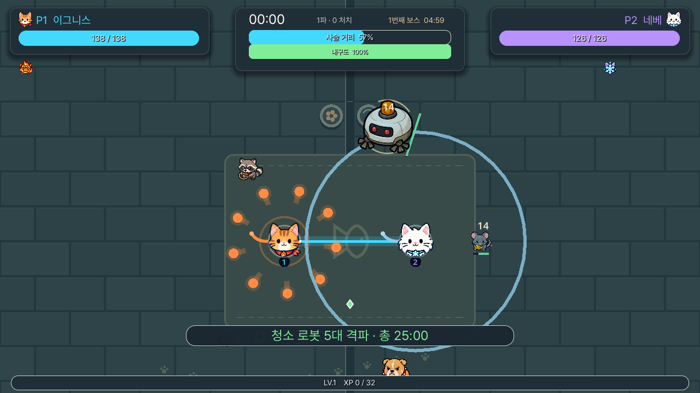

`Godot 4.7.2` · `GDScript` · 로컬 2인 / LAN 2인 / AI 동료 · 한 판 25분 · 보스 5체

### 협동 개편 플레이 방법 (2026-09-12)

- **혼자 + AI:** 게임 시작 → 로비의 `혼자 + AI 동료` 버튼 또는 **B**. P1은 WASD/패드 1로 움직이고 P2는 따라가기·근접 위험/투사체 회피·대시·구조·테크 선택을 자동 처리합니다. AI 캐릭터는 P1의 범위·생존력·기동성 약점을 보완하도록 자동 선택되며, P1을 바꾸면 조합도 다시 계산합니다.
- **로컬 2인:** 기존 참가 방법을 유지합니다. 성장 시 두 사람의 부채꼴 손패를 화면 아래에 동시에 표시하고, 차례가 아닌 쪽을 흐리게 처리합니다. P2 확정 전에는 P1의 취소 키 또는 두 손패 사이의 `P1 다시 고르기`로 되돌아갑니다.
- **테크:** 새 무기는 테크 없이 시작하고, **무기 레벨 3**이 되면 테크를 고릅니다. 선택 직후부터 관통, 유도 화염, 앞뒤 베기, 이중 궤도, 동료 위치 추가 발사 등 공격 방식이 바뀝니다. 테크는 선택지를 막지 않지만 **어떤 강화가 얼마나 오르는지**를 정합니다 — 테크가 특화한 축은 크게, 나머지는 작게 오릅니다. 무기당 테크는 **둘**(화력형 A / 속도형 B)이고, 진화는 **무기 레벨 7**에 자동으로 일어납니다 — 필요한 보물은 없습니다.
- **LAN 2인:** 호스트는 로비에서 **H**, 참가자는 호스트 IP를 입력하고 **J**를 누릅니다. 한 PC에서 시험할 때는 기본값 `127.0.0.1`을 사용합니다. 호스트가 전투 판정을 맡고 참가자의 이동·대시, 캐릭터 확정, 성장 선택, 플레이어·적 상태를 동기화합니다. 인터넷 직접 접속에는 호스트의 UDP `24872` 포트 전달과 방화벽 허용이 필요합니다.

AI는 게임 내부 행동 로직으로 동작하며 API 키나 외부 서비스가 필요하지 않습니다. AI 동료는 일반 적과 투사체뿐 아니라 보스의 사슬 강타 원형 범위와 돌진 경로도 읽고 안전한 쪽으로 이동·대시합니다. 장시간 난이도 조정은 후속 개선 대상입니다.

검증: `tests/coop_rework_test.gd`는 AI 참가·입력 분리·위험 회피·실제 부활·자동 성장·공명 투표·로컬 화면 전환·테크 공격 생성·동료 발사의 피해 귀속을 검사합니다. `tests/online_peer_probe.gd`는 실제 Godot 호스트·클라이언트 두 프로세스를 연결해 캐릭터 합의, 런 시작, 원격 P2 이동, 강제 연결 끊김 뒤 런 복구, 전투 연출, 필드 아이템, 공명 투표, 결과와 같은 조합 재도전까지 검사합니다.


</div>

---

## UI 제작 최우선 원칙

UI는 예쁜 그림보다 **레이아웃 정확도 → 정렬과 공통 기준선 → 가독성과 정보 위계 → 시각적 스타일 → 장식** 순으로 완성합니다. 모든 화면은 공통 그리드와 재사용 컴포넌트를 사용하고, 반복 요소의 크기·padding·아이콘 영역·baseline·버튼 상태를 동일하게 유지합니다. 이미지 생성 시안도 자유 배치나 과한 glow보다 production-ready game UI, geometric alignment, restrained effects를 우선합니다.

상세 규칙과 imagegen에 붙여 넣을 하드 제약 블록은 [UI 제작 및 이미지 생성 지침](docs/ui-generation-guidelines.md)에 정리했습니다. 실제 Godot UI 구현은 [UI 가이드](docs/ui-guide.md)와 `scripts/ui/layout_grid.gd`를 함께 기준으로 삼습니다.

## 목차

| | |
|---|---|
| [빠른 시작](#빠른-시작) · [조작](#조작) | 실행하고 손에 익히기 |
| [사슬](#사슬--이-게임의-전부) · [한 판의 흐름](#한-판의-흐름) · [보스 다섯](#보스-다섯) | 핵심 규칙 |
| [테크트리](#테크트리-기본--보물-강화--공명) · [보물](#보물) · [영구 성장](#클리어-포인트와-영구-성장) · [공명](#공명) | 빌드 만들기 |
| [생존자](#생존자-12명) · [옥상의 불청객](#옥상의-불청객) | 등장하는 것들 |
| [필드 아이템](#필드-아이템) · [옥상](#끝없는-옥상) | 전장 |
| [설계 노트](#설계-노트) · [온라인 2인 구현 상태](#온라인-2인-구현-상태) · [자동 검증](#자동-검증) | 만든 사람용 |

---

## 빠른 시작

배포본은 `moonroof-snack-guardians-win64.exe`를 실행합니다. 같은 PC에서 키보드나 게임패드를 나눠 쓰거나,
LAN 방에 참가하거나, AI 동료를 선택한 뒤 메인 화면의 **게임 시작**을 고릅니다. 게임은 기본적으로 1280×720 창 모드로 열립니다. 메인 메뉴와 일시정지 설정에서 창/전체 화면, 창 해상도(1280×720 · 1600×900 · 1920×1080), 프레임률, 수직 동기화를 조절할 수 있습니다. 전체 화면은 모니터의 기본 해상도를 사용하며 `F11` 또는 `Alt+Enter`로도 켜고 끕니다.

창 모드는 언제나 테두리를 그대로 둡니다. 고른 크기가 작업 표시줄과 제목 표시줄까지 더하면 화면에 들어가지 않으면 16:9를 유지한 채 들어갈 만큼 줄이고(설정 줄이 `화면에 맞춤`으로 알려 줍니다), 창은 항상 화면 안으로 옮겨 놓습니다. 화면을 꽉 채우는 일은 전체화면만 합니다 — 이전에는 1920×1080을 고르면 테두리를 떼고 바탕화면 전체를 덮었는데, 그러면 창을 옮기는 코드가 돌지 않아 클라이언트 영역의 원점이 제목 표시줄 높이만큼 화면 위로 (1080p에서 `(1912, -31)`) 밀려 있었습니다. 마우스 좌표는 그 원점을 기준으로 들어오므로 그림과 포인터가 제목 표시줄 높이만큼 어긋났고, **모든 버튼을 보이는 곳보다 조금 아래로 눌러야** 했습니다. 같은 이유로 창 모드와 전체화면이 픽셀 단위로 똑같아서 전체화면 켜기·끄기가 아무 일도 하지 않는 것처럼 보였습니다.

개발용으로 실행하려면:

1. [Godot 4.7.2 Standard](https://godotengine.org/download/windows/)로 이 폴더의 `project.godot`을 엽니다.
2. `F5`를 누릅니다.

Windows 배포본은 내보내기 템플릿을 설치한 뒤 아래 명령으로 `builds/`에 만듭니다.

```powershell
godot --headless --path . --export-release "Windows Desktop"
```

외부 애드온은 필요하지 않습니다. 효과음은 대부분 실행 중에 합성되고, 핵심 경고음과 음악은 저장소에 포함된 원본 WAV를 재생합니다. 옥상은 로컬 페인팅 타일과 밉맵 손그림 소품 아틀라스를 조합하며 이펙트는 코드가 그립니다.

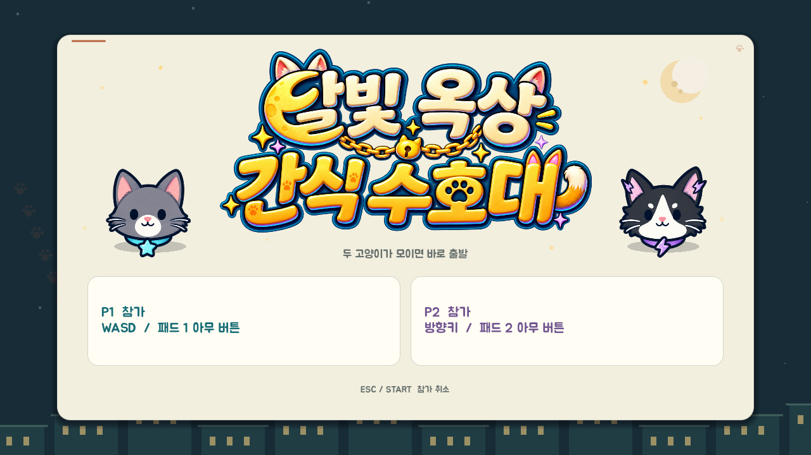

---

## 조작

전투 UI는 상단의 반투명 남청색 패널로 구성됩니다. 좌우에는 P1 청록·P2 보라색으로 체력, 개인 레벨, 무기·보물을 표시하고, 중앙에는 시간·사슬 상태·공유 경험치를 모았습니다. 하단은 전투 시야를 위해 비워두며 메뉴·성장·필살기·결과 화면도 같은 테두리와 색상 규칙을 사용합니다.

체력 막대 아래 장비 칸은 윗줄이 무기, 아랫줄이 보물입니다. 무기 칸의 **테두리 자체가 쿨타임**입니다 — 칸과 같은 둥근 사각형을 따라 위 가운데에서 시계 방향으로 차오르고, 아직 남은 시간만큼 아이콘 위를 어둡게 덮어 내려옵니다(다 차면 음영이 사라지고 테두리가 밝게 닫힙니다). 공명에 묶인 무기는 금색, 늘 켜져 있는 오라 무기는 테두리가 천천히 숨쉬듯 돕니다. 보물은 쿨타임이 없으므로 움직이지 않는 금빛 테두리입니다. 레벨은 오른쪽 아래 모서리의 작은 칩에 적힙니다.

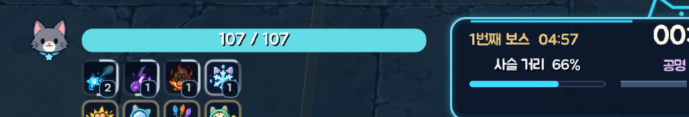

글꼴은 두 벌을 역할로 나눠 씁니다. 화면의 목소리는 **Griun 한글 고운체**(`assets/fonts/GriunXHangeul_Gowoon-Rg.ttf`)로, 제목·카드·설명·대사처럼 종이 위에서 천천히 읽는 글에 씁니다. 전투 중 한눈에 읽는 수치 — 상단 HUD 띠, 시계, 체력·경험치 막대, 보스 바, 피해 숫자, 화면 밖 지시자, 알림 로그 — 는 획이 네 배 두꺼운 **Jua**(`assets/fonts/Jua-Regular.ttf`)로 씁니다. 고운체의 가는 획은 13~16px 야경 위에서 읽히지 않고, Jua는 같은 크기에서 오히려 조금 더 좁아 배치를 바꾸지 않고 바꿔 끼울 수 있습니다. 두 글꼴 모두 없는 기호(`·`, 화살표, 줄표)와 빠진 한글 음절은 **Memoment 꾹꾹**(`assets/fonts/MemomentKkukkukk.ttf`, 한글 11,172자 전부)이 대신 그리며, `CatTheme.adopt()`가 두 글꼴 아래에 폴백으로 겁니다. 세 글꼴 모두 MSDF 없이 일반 안티앨리어싱과 2배 오버샘플링으로 가져와 1920×1080에서도 획이 깨지지 않게 표시합니다.

| | P1 | P2 | 게임패드 |
|---|---|---|---|
| **이동** | `W` `A` `S` `D` | `← ↑ → ↓` | 왼쪽 스틱 |
| **대시** | `Space` | `.` | 오른쪽 트리거 |
| **카드 이동** | `A` / `D` | `←` / `→` | `LB` / `RB` |
| **확정 · 취소** | `W` / `S` | `↑` / `↓` | `A` / `B` |
| **재추첨** | `Q` | `/` | `Y` |
| **상세 보기** | `Tab` | `Tab` | `X` |

공용: `Esc` 일시정지 · 결과 화면에서 `Enter` 같은 조합 재도전, `Esc` 메인 메뉴 · `F11` 또는 `Alt+Enter` 전체 화면 · `F1`~`F4` 화면 흔들림 / 피해 숫자 / 효과음 음량 / 음악 음량 · `F12` 달빛 연출 켜기·끄기([아래](#달빛-옥상)).
마우스로도 참가·선택·카드·메뉴를 모두 조작할 수 있습니다(캐릭터 목록은 좌클릭 P1, 우클릭 P2).

디버그 빌드에서는 `F10`으로 런타임 점검 패널을 엽니다. 전투·사슬·각 플레이어의 실제 적용 능력치와 무기/보물/공명 상태를 실시간으로 볼 수 있고, 패널 안의 `F5`~`F9` 단축키로 배속(2 → 5 → 0.15 → 1배 순환), 레벨업, 즉시 진화, 완전 회복, 다음 보스를 즉시 점검할 수 있습니다. 패널을 닫으면 배속은 **패널을 열기 전의 값**으로 돌아갑니다. 단축키로 상태를 바꾼 런은 보상과 강화 발견을 저장하지 않으며, 릴리스 빌드에서는 패널이 활성화되지 않습니다.

`F11`은 같은 패널에 **프레임 계측**을 붙입니다. 런은 예전부터 물리 틱을 단계별로 재는 타이머를 들고 있었지만(`main._profile`) 그건 헤드리스 성능 테스트만 읽을 수 있었습니다. 그래서 "지금 이 빌드가 느리게 느껴진다"와 "틱의 어느 단계가 비싼가"가 서로 다른 조사였고, 두 번째는 사람이 실제로 플레이하던 화면이 아니라 언제나 스크립트가 만든 상황에 대해서만 이뤄졌습니다. `F11`은 같은 카운터를 켜서 0.16초짜리 창으로 굴려 보여줍니다.

읽는 순서가 곧 화면의 순서입니다.

1. **프레임 비용** — FPS, 프레임 ms, 60Hz 예산 대비. 그리고 엔진 자체의 `_process`/`_physics` 계측값.
2. **틱 단계별 막대** — `enemy_ai` · `grid_rebuild` · `crowd_separation` · `weapons` · `hud` 등이 한 틱 예산 중 얼마를 쓰는지.
3. **살아 있는 것의 수** — 적(화면 밖 몇, 상한 몇) · 경험치 결정 · 적 탄 · 투사체 · 우유 웅덩이 · 무기 장판 · 지뢰, 그리고 드로우 콜과 그려진 오브젝트 수.

세 번째 블록이 있는 이유는 **앞의 둘이 "어느 단계가 비싸다"까지만 말하고 "왜"는 절대 말하지 않기 때문**입니다. `weapons 6ms`는 그 자체로는 아무 의미가 없고, 옆에 `투사체 340`이 붙어야 진단이 됩니다.

1번 블록이 가장 중요합니다. **물리 틱 합계가 1.8ms인데 프레임이 7ms라면, 2번의 막대를 아무리 들여다봐도 시간 낭비**입니다 — 시뮬레이션은 문제가 아니라는 뜻이고, 단계별 타이머만으로는 그 사실을 절대 말할 수 없습니다.

`F12`는 **전투 렌더링만 끕니다**(무기 컨트롤러 · 파티클 · 폭발 · 군중 렌더러의 공격 예고). 시뮬레이션은 그대로 돌아가므로, 같은 상황에서 켜고 끈 두 수치의 차이가 곧 전투 이펙트가 쓰는 렌더 비용입니다.

이 도구들로 재고 고친 결과는 [성능 — 원인 분석과 적용](docs/performance-2026-09-19.md)에 있습니다. 당시 후반 빌드(적 620마리, 진화 무기 8정)에서 **프레임 p50 152ms → 5.1ms, p99 215ms → 18.6ms**. 가장 큰 원인은 무기가 아니라 **HUD가 매 틱 같은 색을 다시 칠하던 것**이었습니다 — `add_theme_color_override`는 같은 색이어도 라벨 텍스트를 다시 셰이핑하게 만들고, 그 일은 스크립트가 끝난 뒤 엔진 쪽에서 일어나 어떤 타이머에도 잡히지 않았습니다. F11 패널은 이제 main 구간 아래에 **노드별(틱당)** 상위 항목(`FrameProbe`)을 보여줍니다.

`F11`과 `F12`는 원래 **전체화면**과 **달빛 연출** 키입니다. 그래서 인스펙터는 **패널이 열려 있는 동안에만** 그 둘을 빌려 쓰고, 그동안 게임 쪽은 자기 토글을 내려놓습니다(`main._input`). 패널을 닫으면 두 키는 원래 기능으로 돌아갑니다 — 한쪽만 고쳤다면 한 번 누를 때 두 기능이 같이 발동했을 것입니다.

패널은 화면 오른쪽 절반에 서는데, 거기는 성장 카드·캐릭터 목록처럼 **P2가 쓰는 자리**입니다. 그래서 `F6`·`F7`이 여는 선택 화면을 패널이 그대로 덮으면, 정작 그 단축키가 보여주려던 카드가 가려집니다. 선택 화면이 떠 있는 동안 패널은 화면 맨 아래의 **클릭이 통과하는 띠**로 접혀 지금 어느 화면인지·배속이 얼마인지·마지막 명령이 무엇이었는지만 남기고, 화면을 닫으면 저절로 다시 펼쳐집니다.

> **공격은 자동입니다.** 모든 무기가 가장 가까운 적을 스스로 겨눕니다. 예전에는 이동 방향으로 발사돼서 도망치면 도망치는 쪽으로 쏴야 했는데, 사슬에 묶인 채 조향과 조준을 동시에 요구하는 건 무리였습니다. 부채꼴은 여전히 부채꼴이고 직선은 여전히 직선입니다 — 겨누는 일만 덜어냈습니다.

### 대시

0.18초 동안 3.2배 속도로 돌진하며 **0.26초간 무적**입니다(재사용 1.4초). 돌진 거리는 약 132px, 사슬은 260~500px — **일부러 사슬보다 짧습니다.** 동료 반대 방향으로 대시하면 사슬에 걸려 둘이 함께 끌려갑니다. 도주 수단이 아니라 회피 수단입니다.

다운된 고양이는 대시할 수 없습니다. 구조에서 도망치는 수단이 되면 안 되니까요.

---

## 사슬 — 이 게임의 전부

사슬 길이는 **고른 두 고양이가 정합니다.** 기본 330px에 각 고양이가 가진 `사슬` 값을 더한 것이 그 판의 한계입니다 — 모로처럼 발톱 거리에서 싸우는 고양이는 짧게(−35), 세린처럼 자리를 지키는 고양이는 길게(+85) 만듭니다.

| 조합 | 사슬 |
|---|---:|
| 모로 + 라이라 (최단) | 275px |
| 평균적인 한 쌍 | 약 380px |
| 세린 + 네베 (최장) | 480px |

짧은 사슬은 둘을 한 덩어리로 만들고, 긴 사슬은 전장을 두 배로 넓히는 대신 서로를 못 지키게 합니다. **캐릭터 선택 화면에서 정해지고 그 뒤로는 바닥에 그려진 밧줄의 길이로만 보입니다.**

사슬은 네 단계로 변합니다.

| 상태 | 장력 | 효과 |
|---|---|---|
| 안정 | ~70% | — |
| 저항 | 70%+ | 내구도 회복 정지 |
| **과충전** | 82%+ | **공격력 +25%**, 내구도 소모 |
| 한계 | 95%+ | 내구도 급속 소모 |

즉 **위험하게 떨어져 있을수록 강해집니다.** 내구도를 0까지 태우면 **과부하**가 걸려 공격력이 20% 깎이고, 다시 붙어 있어야 풀립니다.

한 명이 쓰러지면 18초 안에 동료가 105px 이내에서 2.6초를 버텨야 부활합니다. 쓰러진 고양이도 느리게 기어갈 수 있고, 사슬에 끌려오기도 합니다.

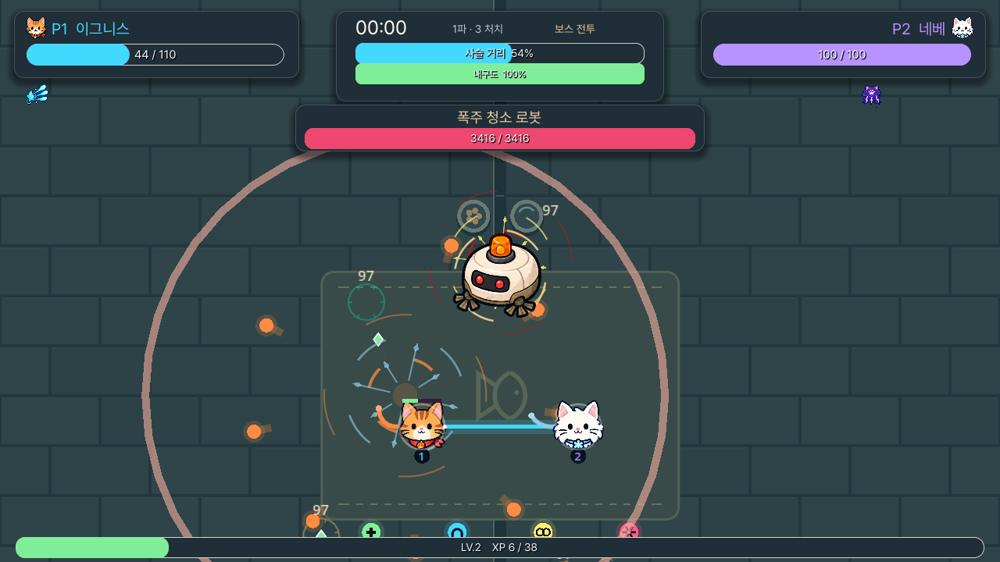

---

## 한 판의 흐름

한 판은 **25분**이고, 그 안에 보스가 **다섯 번** 옵니다.

```
0:00 ─── 2:30 ─── 5:00 ─── 10:00 ─── 15:00 ─── 20:00 ─── 25:00 ─► 최종전
  │        │        │         │         │         │         │
추격자만  첫 조우   1번째    2번째     3번째     4번째    최종 관제 코어
        (78초마다) 청소로봇  드론모함  옥상관리자 구역통제기
```

25분에 마지막 보스가 등장하고, 이를 쓰러뜨리면 승리합니다.

- 적은 **30초짜리 파(wave)** 단위로 옵니다. 파가 열릴 때 한 무리가 한꺼번에 쏟아지고, 마지막 **6초는 휴식**입니다.
- **3파마다** 훨씬 큰 대규모 공세가 예고와 함께 들어옵니다.
- 휴식 중에도 엘리트와 보스는 나옵니다. 스웜에서 잠시 벗어나는 시간이지, 안전이 보장된 창이 아닙니다.
- 두 사람에게서 **1500px 넘게** 멀어진 적은 회수됩니다(보스 제외). 회수는 처치가 아니라 경험치도 드랍도 없습니다.
- 난이도 눈금은 62초당 1입니다. 후반 가속 램프는 **248초 이후에만** 작동합니다 — 초반은 이미 가혹한 쪽이라 더 어렵게 만들 이유가 없습니다.

25분짜리 곡선에는 **상한**이 붙어 있습니다. 접촉 피해는 아키타입 기본값의 **2.8배**에서, 이동 속도는 **+34**에서 멈춥니다. 체력은 계속 오릅니다 — 화력도 같이 오르니까요. 원샷만은 어떤 빌드로도 답할 수 없어서 막았습니다. 대신 후반 처치의 경험치가 올라가므로(난이도 1당 +20%) 25분째의 한 마리는 실제로 더 값집니다.

### 이름 붙은 조우

2분 30초부터 **78초마다** 하나씩, 다섯 가지가 순서대로 돌아옵니다. 오기 전에 이름이 뜨므로 어떻게 설지 정할 시간이 있습니다.

| 조우 | 무엇을 묻는가 |
|---|---|
| **군체 해일** | 벼룩 떼가 두 배로 쏟아집니다. 자리만 잡혀 있으면 공짜 경험치, 아니면 벽 |
| **돌진 폭주** | 경비견 12마리가 **한 방향에서 한 줄로**. 답은 옆으로 비키는 것 — 사슬 때문에 반사가 아니라 합의가 됩니다 |
| **포위 진형** | 16마리가 **틈 없는 원**으로 동시에 나타납니다. 넓게 쓰는 무기와 강화 무기가 존재하는 이유 |
| **정예 편대** | 엘리트 4체 동시 등장 |
| **대범람** | 사방에서 한꺼번에. **7분 이후에만** 나오고, 20분에는 백 마리를 넘깁니다 |

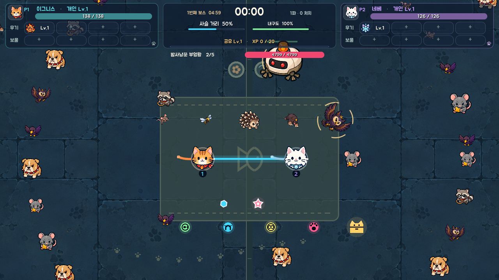

### 몸은 통과하지 않습니다

적은 저마다 가장 가까운 고양이를 향해 자기 직선으로 걸었습니다. 비슷한 방향에서 나온 것들은 그래서 **한 점으로 수렴**했습니다 — 쥐 스무 마리가 쥐 한 마리 크기의 실루엣 안에 겹쳐 서서, 하나로 보이는 형체에서 스무 마리분의 접촉 피해를 냈습니다. 떼로 몰려오는 게 존재 이유인 군체가 가장 심했습니다.

지금은 겹친 몸이 서로 밀어냅니다. 한 번에 완전히 떼어놓지 않고 **여러 틱에 걸쳐 조금씩** 미는데, 빽빽한 무리에서 한 번에 해결하면 서로가 서로의 보정을 취소해 부들부들 떨기 때문입니다. 크기가 밀림의 정도를 정하므로 쥐는 방벽에 튕기고, **보스는 아예 밀리지 않습니다** — 필드에서 위치가 곧 약속인 유일한 존재라서요. 고양이도 한쪽으로만 단단합니다: 적은 고양이 밖으로 밀려나지만 고양이는 절대 밀리지 않습니다. 조작을 뺏기는 순간이 하필 가장 중요한 순간이 되니까요.

그리고 이게 더 큰 무리를 의미 있게 만듭니다. **같은 점에 겹칠 수 있는 이백 마리는 떼가 아니라 더미입니다.** 초기 군중 개편에서는 동시 상한을 420에서 **620**으로 올리고, 파 간격을 더 가파르게(하한 0.16초 → 0.10초) 했습니다. 현재는 무리 배율 2가 적용되어 **동시 상한이 1,240마리**입니다. 아래의 620마리 성능 수치는 당시 측정 기록이며, 현재 최대 규모는 `frame_budget_test`가 따로 측정합니다.

대신 **초반은 오히려 얇아졌습니다.** 무기가 전부 느려진 만큼 첫 1분은 넓혀야 했습니다 — 첫 파 간격은 현재 1.20초이고, 셋째 파까지 완만한 구간을 늘렸습니다. 어려워져야 하는 건 중반 이후지 배우는 동안이 아닙니다.

<a id="보스-다섯"></a>

### 보스 다섯

`5:00`부터 **5분마다** 한 대씩 옵니다. 앞선 넷은 관문이지 결승선이 아닙니다 — 쓰러뜨리면 둘 다 체력 절반을 회복하고, 사슬 내구도가 가득 차고, 확정 드랍을 하나 남기고, 판은 계속됩니다.

| # | 시각 | 이름 | 체력 | 접촉 |
|---:|---:|---|---:|---:|
| 1 | 5:00 | 폭주 청소 로봇 | 3,526 | 30 |
| 2 | 10:00 | 경비 드론 모함 | 5,419 | 33 |
| 3 | 15:00 | 옥상 관리자 | 8,280 | 36 |
| 4 | 20:00 | 구역 통제기 | 12,588 | 39 |
| 5 | 25:00 | **최종 관제 코어** | 19,056 | 42 |

랭크당 1.42배입니다 — 두 배가 아닙니다. 보스 사이 5분 동안 페어의 화력이 대략 그만큼 오르므로, 다섯 판이 서로 **비슷한 길이의 싸움**이 되게 맞춘 값입니다. 3번째부터는 격노 문턱이 올라가 대부분의 시간을 돌진 패턴까지 쓰는 상태로 보냅니다.

**둘이 동시에 새 보스와 마주치는 일은 없습니다.** 앞의 보스가 아직 살아 있으면 다음 보스는 대기합니다 — 느린 싸움이 체력 바 두 개로 불어나지 않게.

`최종 관제 코어`를 쓰러뜨리면 승리, 둘이 동시에 다운되거나 출혈 시간이 끝나면 패배입니다.

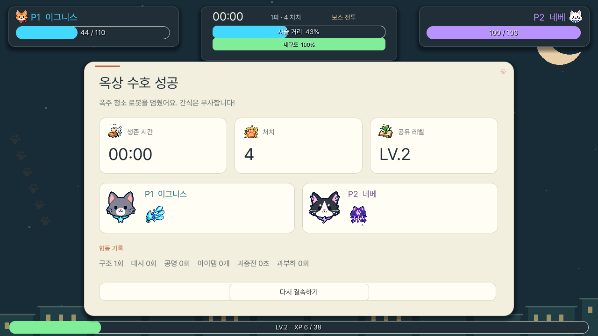

결과 화면은 공유 레벨과 별도로 **P1·P2 개인 레벨**을 비교합니다. 개인 레벨은 실제로 경험치 결정을 주운 쪽에 누적되며, 각 플레이어의 주운 XP·아이템 수·총 DPS와 현재 무기별 실제 DPS도 함께 남습니다. 협동 기록에는 획득한 필드 아이템을 종류별로 집계합니다.

---

## 테크트리: 무기 → 테크 → 진화 → 공명핵 → 공명

> 2026-09-17에 이 시스템 전체를 개편했습니다. 무엇을 왜 바꿨는지는
> [무기 성장·진화·공명 개편](docs/weapon-system-rework-2026-09-17.md)에 있습니다.

규칙은 네 문장입니다.

```
  Lv.3에 방향을 고른다.
  Lv.7에 자동으로 진화한다.
  진화 무기 두 개의 태그가 맞으면 공명 후보가 생긴다.
  보스를 잡으면 공명핵으로 그중 하나를 고른다.
```

처음 얻은 무기는 **테크 없이** 시작합니다. 레벨 1→3의 두 장은 무기가 무엇을 하는지 익히는 구간이고, **레벨 3에 도달하면 다음 성장 화면이 그 무기의 테크를 묻습니다.** 테크를 고르기 전에는 그 무기가 더 오르지 않으며(상자 보상도 마찬가지), 무기마다 테크는 **정확히 둘**입니다.

```
  기본 무기 Lv.1~3 ─► 테크 선택(Lv.3) ─► 테크 특화 강화 Lv.3~7
                                        └► Lv.7 자동 진화 ─► 최종 무기 ─► Lv.12까지 강화
  P1 최종 무기 + P2 최종 무기 ─► 공명 가능 ─► 보스 격파 → 공명핵 ─► 공명 선택(최대 2개)
```

무기+무기 합성은 없습니다. 무기당 최종 형태는 **하나**이고, 고른 테크는 진화 뒤에도 공격 방식과 강화 효율로 남습니다 — 혜성 추적으로 키운 성좌 관통포와 무한 추적으로 키운 성좌 관통포는 계속 다른 무기입니다.

**진화 조건은 무기 레벨 7 하나뿐입니다.** 예전에는 여기에 "고른 테크가 지정하는 보물을 레벨 4까지" 가 붙어 있었습니다. 그건 레벨 3 카드가 여섯 레벨 뒤의 요구 조건을 결정하는 구조였고, 그 요구 조건은 정할 당시 화면 어디에도 없었습니다 — 엉뚱한 보물 네 개를 들고 레벨 7에 도착해서 무기가 왜 멈췄는지 모르는 것이 실패 양상이었습니다. 보물은 이제 **시너지**일 뿐 관문이 아닙니다([보물](#보물)).

**진화는 카드도 아닙니다.** 레벨 7에 닿는 순간 그 자리에서 진화합니다. "이미 값을 다 치른 것을 이제 사시겠습니까"는 선택이 아니라 전원이 매번 집는 카드였고, 그 카드가 실제로 저울질할 수 있는 카드의 자리를 하나 차지하고 있었습니다.

진화는 무기의 **끝이 아니라 중간**입니다. 최종 무기도 **레벨 12까지** 화력·속도 카드를 받고, 최종 무기에 해당 필드가 남아 있다면 원래 무기의 고유 강화도 계속 받습니다(예: 성좌 관통포의 동시 발사, 초신성의 폭발 반경). 진화 전에 키운 피해·쿨다운은 **100% 그대로 이어집니다** — 예전에는 35%만 남아서, 트리가 보상하는 바로 그 순간에 그때까지 산 화력 카드의 3분의 2가 증발했고 그 사실을 알려주는 화면은 없었습니다.

### 초반은 가볍게, 후반은 무겁게

카드 한 장의 값은 무기의 **단계**와 **테크**가 정합니다(`scripts/systems/weapon_growth.gd`). 예전에는 첫 카드와 마지막 카드가 같은 값이라 무기가 강해지는 구간이 런 초반에 몰려 있었고, 최종 무기는 남은 3분의 1을 12.6%짜리 카드로 보냈습니다.

| 단계 | 조건 | 마력 증폭(피해) | 고속 시전(쿨다운) | 고유 강화 수치 |
|---|---|---:|---:|---:|
| 시작 | 테크 없음 · Lv.1~3 | ×1.12 | ×0.96 | ×0.70 |
| 테크 | 테크 선택 후 · Lv.3~7 | ×1.16 | ×0.94 | ×0.85 |
| 최종 | 최종 무기 · Lv.7~12 | ×1.19 | ×0.93 | ×1.00 |

시작 무기 피해 배율은 0.68 → **0.62**입니다. 보물도 같은 모양입니다([보물](#보물)).

### 그리고 성장은 어딘가에서 멈춥니다

위 표는 2026-09-19에 전부 낮아졌습니다(`×1.16/1.26/1.30` → `×1.12/1.16/1.19`). 곱셈으로 쌓이는 값에 천장이 하나도 없었던 것이 이 게임이 가진 가장 큰 밸런스 실패였기 때문입니다. 계측한 결과는 이렇습니다.

| | 고치기 전 | 고친 뒤 |
|---|---:|---:|
| 화력 카드 11장을 한 무기에 몰았을 때 피해 배율 | **×35** | ×9~16 |
| 궤도 파편(원래 6.6초) 최종 발동 간격 | 0.84초 | 1.82초 |
| 초신성(원래 2.02초) 최종 발동 간격 | 0.25초 | 0.48초 |
| 성좌 관통포 한 번에 나가는 투사체 | 18발 | 9발 |
| 크림 해일 웅덩이 수 · 반경 | 22개 · 189 | 12개 · 164 |

여기에 **격노의 인장**(공격력 ×2.2)이 다시 곱해졌으므로, 한 무기에 전념한 한 쌍은 런 중반에 이미 시작 화력의 **일흔 배** 근처였습니다. 웨이브 난이도는 그런 곡선을 답할 수 없고, 12분 이후는 전부 요식 행위였습니다.

천장은 세 개이고 전부 **무기 자신의 카탈로그 값**에 대한 비율입니다 — 진화한 무기는 자기 진화형의 값을 기준으로 삼으므로, 원래 넓던 무기는 계속 넓습니다.

- **속도**: 어떤 무기도 자기 원래 간격의 **45% 아래로 내려가지 않습니다**(카드만으로). 질풍의 태엽과 광란까지 더해도 **3분의 1**이 끝입니다. 예전에는 전부 똑같은 0.25초 하한에 붙어서, 6.6초짜리 궤도 파편과 1.1초짜리 유도 별탄이 후반에 같은 박자로 쐈습니다 — 로스터가 통째로 납작해지는 것과, 렌더러가 따라가지 못하는 것이 같은 원인이었습니다.
- **수량**: `발사 수`·`연쇄` 계열은 자기 카탈로그 값 **+3**에서 멈춥니다.
- **크기**: `반경`·`사거리`·`범위`는 자기 카탈로그 값의 **1.85배**, `탄속`은 1.7배, `인력`은 1.9배에서 멈춥니다.

**분열의 화살통**은 단계마다 발사체 +1을 줬습니다. 10단계면 모든 수량 무기에 **+10발** — 1발 쏘는 무기에게는 열한 배입니다. 이제 두 단계마다 +1(총 +5)이고, 생존자 위에 소수점으로 쌓였다가 실제로 발사할 때 내림합니다.

**우유 웅덩이에는 동시 상한 30개**가 생겼습니다. 웅덩이는 4.6초 × 지속 배율을 살고 아무도 일찍 치우지 않았으므로, 살아 있는 수 = 시전 빈도 × 한 번의 개수 × 수명이었고 셋 다 천장이 없었습니다. 후반 크림 해일은 백 개가 넘게 깔려 적의 예고 표시조차 읽을 수 없었습니다. 가장 오래된 것이 자기 페이드로 마르며 자리를 내줍니다 — 결계 지뢰가 예전부터 쓰던 방식과 같습니다(`MINE_CAP_PER_PLAYER`).

**모든 테크는 같은 모양입니다.**

| | 성격 | 항상 특화하는 축 | 고유 축 |
|---|---|---|---|
| **A** | 강한 한 방 · 화력형 | 마력 증폭 | 고유 A 또는 B 하나 |
| **B** | 빠른 반복 · 수량/속도형 | 고속 시전 | 나머지 하나 |

한 무기의 레벨 3 선택을 이해한 사람은 열두 무기의 레벨 3 선택을 전부 이해한 것입니다. 이 모양은 `tests/weapon_data_test.gd`가 기계적으로 검사합니다.

**균형형 테크 다섯 개는 없앴습니다.** 성좌 설계 · 화염 성운 · 월식 · 지평 광선 · 추적 놀이는 전부 네 축을 고르게 올리는 "고르게 완성합니다" 계열이었고, 그건 방향이 아니라 안전해 보이는 기본값이었습니다. 아무것도 특화하지 않는 선택지는 선택지가 아닙니다. 대신 사슬에 **팽팽한 사슬**(약한 파동 두 번)을 더해, 테크가 하나뿐이라 자동으로 정해지던 유일한 무기도 이제 묻습니다.

**테크는 강화 값을 정합니다.** 테크가 특화한 두 축은 위 값의 **1.30배**, 나머지 두 축은 **0.75배**로 오릅니다. 발사 수·연쇄처럼 정수로 오르는 특화 강화는 +1에 더해 피해가 4~8% 오릅니다. 카드에는 `테크 특화` / `테크 외`가 적힙니다. 테크를 고르는 데 성장 손패 하나를 쓰므로, **고르는 즉시 그 테크의 첫 특화 강화가 한 번 무료로 적용됩니다**(카드의 `+1`). 테크 카드는 그 테크와 잘 맞는 **추천 보물**과 레벨 7에 도달할 최종 무기 이름을 함께 적습니다.

**테크 때문에 쓸모없어지던 고유 강화는 테크 전용 강화로 바뀝니다.**

| 테크 | 원래 강화 | 바뀐 강화 |
|---|---|---|
| 연쇄 낙뢰 · 과부하 (연쇄 1회 고정) | 연쇄 전도(연쇄 +1) | **낙뢰 폭심** — 첫 적 착탄 폭발 반경 +20 |
| 관통 광선 · 심판 (광선 1줄 고정) | 분광(광선 +1) | **심판의 창날** — 창 폭 +7 |
| 추적 성탄 · 혜성 추적 | 마력 추진(탄속) | **혜성 꼬리** — 추가 관통 +1 |
| 화염 성운 · 작은 태양 | 열풍 추진(탄속) | **태양 흑점** — 추가 관통 +1 |

봉쇄 정원(지뢰)의 원형 지뢰밭은 최소 4개 고정이라 `다중 매설`이 3장 동안 아무 일도 안 했습니다. 지금은 **매설 수 + 3개**를 심습니다.

캐릭터 선택 화면부터 두 테크 이름, 추천 보물, 최종 무기 이름을 보여줍니다. 레시피를 외운 사람만 슬롯을 제대로 쓰는 구조를 없앴고, 발견 기록은 수집 기록으로만 남습니다.

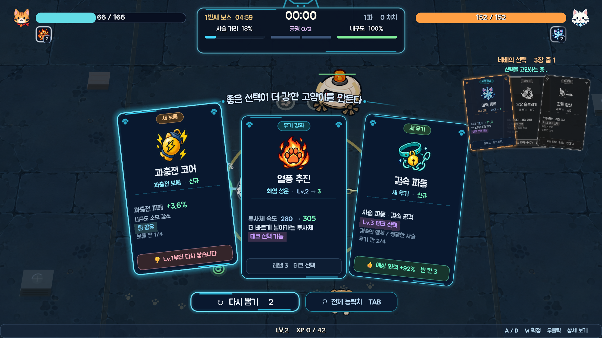

### 카드 읽는 법

카드는 역할별로 칸이 나뉘어 있고, 결정하는 순서대로 읽힙니다.

| 위치 | 내용 |
|---|---|
| 맨 위 칩 | 카드 종류. 색으로 구분합니다 — 무기 강화 하늘색, 새 무기 초록, 보물 강화 금색, 새 보물 주황, 테크 보라 |
| 이름 | 강화 이름만(`마력 증폭`, `재생의 성수`). 예전엔 무기 이름과 두 줄로 붙어 있어 어느 쪽이 강화 이름인지 헷갈렸습니다 |
| 이름 아래 | 적용 대상과 레벨 — `화염 성운 · Lv.6 → 7`, 새 장비는 `신규` |
| 수치 줄 | **지금 값**(하늘색) → **강화 후 값**(민트색, 한 단계 크게). 보물은 한 단계 증가분이 아니라 **누적 합계**를 보여줍니다 |
| 효과 | 무엇이 달라지는지 한 줄로 |
| 태그 | `테크 특화` · `테크 외` · `이 카드로 진화` · `테크 선택 가능` · `팀 공유` · `최대 레벨` |
| ✦ 금색 줄 | 시너지 — 카드의 성질이 아니라 빌드에 대한 조언이라 따로 표시합니다 |
| 작은 글씨 | 칸 사용(`보물 칸 2/4`), 테크 경로, 진화 결과 |
| 맨 아래 | 추천 👍 / 비추천 👎 / 중립 한 줄 |

안내 문구 `좋은 선택이 더 강한 고양이를 만든다`는 카드 부채꼴 위에 부채와 같은 곡률로 휘어져 있고, `전체 능력치` 버튼은 `다시 뽑기` 옆에 나란히 있습니다.

### 시너지 보물은 먼저 제안합니다

테크를 고르면 그 테크와 맞는 보물을 아직 안 가졌을 때 일반 무작위 보물보다 먼저 카드 풀에 넣습니다. 카드에는 `필수`가 아니라 금색 **`✦ (무기) 시너지`** 줄이 붙고, 카드 귀퉁이의 문장은 그 보물을 이미 가졌을 때만 나타나 "이 둘은 잘 맞습니다"를 말합니다.

예전에는 이 자리가 관문이었기 때문에 **발견 자체를 배급**해야 했습니다 — 아직 보물이 필요한 테크가 있으면 처음 보는 보물은 손패에서 빠졌습니다. 안 그러면 보물 칸을 엉뚱한 것으로 채우고 무기가 영영 진화하지 못했으니까요. 이제 아무것도 무기를 멈출 수 없으므로 배급도 없앴고, 두 사람은 계속 새 보물을 보게 됩니다.

`Tab` 상세 창은 현재 테크, 최종 무기, 레벨 7까지 남은 칸을 하나의 눈금으로 표시합니다 — 예전의 `무기 5/7 + 보물 2/4`는 두 개의 시계였고 그중 하나만 두 사람이 확실히 움직일 수 있었습니다.

### 추천은 없을 수도, 여러 개일 수도 있습니다

예전에는 별이 **항상 정확히 하나** 붙었습니다. 셋이 도토리 키재기일 때도 "정답이 있다"고 우기고, 셋 다 시원찮을 때도 그중 제일 나은 걸 좋은 카드인 양 내밀었습니다.

지금은 카드가 절대 기준(46점)과 상대 기준(최고점의 84%)을 **둘 다** 넘겨야 별을 받습니다. 반대쪽도 있습니다 — 이 빌드에 아무것도 해주지 못하는 카드는 **▽ 비추천**으로 이유와 함께 표시됩니다(`지금 무기와 맞지 않음`, `마지막 무기 칸을 씁니다`, `지금은 효과 없음`).

**2026-09-18에 점수 자체를 고쳤습니다.** 그전까지 모든 카드는 손으로 정한 표값에서 출발했고, 예상 화력 증가가 조금이라도 있는 카드는 그 표값을 **버리고** 증가폭만으로 다시 매겼습니다. 그래서 팀 화력을 실제로 8% 올리는 보물이 `25 + 0.08×220 ≈ 43`점으로 계산되어, 화력과 무관한 아홉 목숨 리본의 표값 58점에 졌습니다. 4%짜리 무기 카드는 34점을 받고 **비추천이 찍혔습니다.** 화면은 "이 빌드에 얼마나 쓸모 있는가"와 "우리 화력을 얼마나 올리는가"를 같은 숫자인 양 비교하고 있었고, 어느 잣대에 걸리느냐에 따라 조언이 뒤집혔습니다. 예상 화력은 이제 표값을 **더하는 항**이므로 두 반쪽이 하나의 단위로 합쳐집니다.

같은 이유로 **칸 압박**이 양쪽에 붙었습니다. 무기도 보물도 4칸이므로 한 칸은 로드아웃의 4분의 1이고, 화면이 해줄 수 있는 가장 쓸모 있는 말은 "이 카드는 그 한 칸을 쓴다"입니다. 새 무기는 빈 칸이 많을수록 높게, 마지막 칸을 쓸 때는 낮게 매겨집니다.

조언이 지키는 규칙 넷:

- 손패에서 **가장 낮은 카드는 절대 별을 받지 않고**, **가장 높은 카드는 절대 비추천이 되지 않습니다.** 무엇을 골라도 손해라고 말하는 화면은 조언이 아닙니다.
- 한 판에서 별과 비추천은 각각 **손패의 절반까지**입니다. 3장에 별 하나, 비추천 둘은 규칙상 합법이지만 읽히기로는 "너는 이미 졌다"입니다.
- 최고점과 최저점이 **9점 안쪽이면 아무 표시도 하지 않습니다.** 도토리 키재기에 정답을 지어내지 않습니다.
- 다만 **효과가 0인 카드**(쿨다운 하한에 닿은 무기의 `고속 시전` 같은)는 위 규칙과 무관하게 먼저 비추천이 붙습니다. 그건 옆 카드와의 비교가 아니라 그 카드에 대한 사실입니다.

레벨업 카드는 다섯 종류입니다 — **테크 결정 · 무기 강화 · 새 무기 · 새 보물 · 보물 강화**. 최종 진화 카드는 없어졌습니다(레벨 7에 자동입니다). 새 무기 카드는 무기당 한 장이며, 테크는 그 무기가 레벨 3이 됐을 때 따로 고릅니다. 무기와 보물이 최대 레벨이면 해당 강화는 풀에서 빠집니다.

### 손패는 뽑기가 아니라 배분입니다

예전에는 유효한 카드를 전부 한 봉지에 넣고 섞었습니다. 그 봉지는 **만드는 순간부터 기울어 있었습니다** — 지닌 무기 하나가 넉 장(`화력` · `속도` · `특성 A` · `특성 B`), 지닌 보물 하나가 한 장을 넣는데, 맞은편에는 새 무기 두 장과 새 보물 몇 장뿐이었습니다. 무기 넷과 보물 넷을 갖춘 생존자는 **스무 장 남짓 중 전부가 "이미 가진 걸 더 키워라"인 봉지**에서 석 장을 뽑고 있었던 셈입니다.

초반이 형식적으로 느껴진 이유가 이것입니다. 거의 매 레벨 잘 굴러가는 그 무기의 피해 카드가 나오니 첫 무기가 눈덩이처럼 커지고, 레벨은 더 빨리 오르고, 로드아웃 칸이 물으려던 질문은 한 번도 나오지 않았습니다.

지금은 손패를 **범주별로 배분합니다.**

| 범주 | 내놓는 카드 |
|---|---|
| 무기 성장 | 지닌 무기 **하나당 한 장** — 그 무기 자신의 축 중에서 뽑습니다 |
| 보물 성장 | 아직 티어가 남은 보물 하나당 한 장 |
| 신규 무기 | 무기 칸이 남아 있을 때만 |
| 신규 보물 | 보물 칸이 남아 있을 때만 |

**"무기 하나당 한 장"이 핵심입니다.** 한 무기가 한 손패에서 두 칸을 차지할 수 없으므로, 장비를 더 많이 들어도 발견이 손패에서 밀려나지 않습니다 — 그저 각 장비가 덜 자주 제안될 뿐이고, 4칸짜리 로드아웃은 원래 그렇게 느껴져야 합니다.

그 위에 자리 둘이 예약돼 있습니다. **무기 성장 한 장**은 항상 들어갑니다(강화, 나아가 공명으로 가는 길이 레벨뿐이므로). 그리고 **칸이 하나라도 비어 있으면 처음 보는 장비 한 장**이 항상 들어갑니다 — 발견이 운에 맡겨지지 않고 상시 제안이 되도록. 행운은 이 배분에서 신규 쪽 가중치를 올립니다.

**경험치에는 상한이 없습니다.** 예전에는 두 사람의 빌드가 다 완성되면 거기서 셈이 멈췄습니다 — 게이지가 얼고, 바닥에 남은 보석이 값을 잃고, 25분 런의 마지막 구간이 아무 보상도 주지 않았습니다. 지금은 완성된 빌드 이후의 모든 레벨이 **초월 성장**으로 바뀝니다. 화면은 열리지 않고, 두 사람의 공격력과 최대 체력이 한 단계씩 함께 오르고, 상단 게이지에는 `LV.n 초월 m`이 적힙니다. 고를 것이 없어지는 것과 셈이 멈추는 것은 다른 일입니다.

### 무기마다 고유 강화 두 개

각 무기에는 공용 두 장(`마력 증폭`, `고속 시전` — 값은 위 단계표)과 고유 강화 두 장이 있습니다. 고유 강화는 전부 공통 Primitive(`Count` · `Range` · `Radius` · `ProjectileSpeed` · `Pierce` · `Chain` · `Slow` · `Force` · `Area`)로 표현되므로 무기별 전용 강화 계산 함수는 없습니다. A 테크는 그중 하나를, B 테크는 나머지 하나를 특화합니다.

| 무기 | 고유 강화 |
|---|---|
| 추적 성탄 | 다중 유도(동시 발사 +1) · 마력 추진(탄속 +46) |
| 연쇄 낙뢰 | 연쇄 전도(연쇄 +1) · 확장 도체(첫 타격 사거리 +36) |
| 화염 성운 | 불씨 범람(화염탄 +1) · 열풍 추진(탄속 +36) |
| 빙결 고리 | 혹한 영역(반경 +19) · 동상(감속 강화) |
| 월식 낫 | 긴 자루(사거리 +19) · 보름베기(각도 +10°) |
| 결속 파동 | 넓은 파동(폭 +9) · **느슨한 족쇄(사슬 한계 +30)** |
| 궤도 파편 | 파편 증식(파편 +1) · 확장 궤도(반경 +14) |
| 관통 광선 | 장사정(사거리 +58) · **분광(광선 +1)** |
| 지뢰 결계 | 다중 매설(매설 +1) · 광역 결계(폭발 반경 +14) |
| 중력 붕괴 | 사건 확대(붕괴 반경 +22) · 강한 인력(인력·사거리 증가) |

**궤도 파편 · 관통 광선 · 지뢰 결계 · 중력 붕괴에는 원래 고유 강화가 하나도 없었습니다.** 로스터 절반이 한 판 내내 피해와 쿨다운 두 장만 받을 수 있었다는 뜻입니다.

### 초반 약화, 후반 가속

숫자가 전부 한 번 내려갔습니다. 가장 크게 느껴지는 건 **연사**입니다 — 모든 무기의 쿨다운이 약 22% 늘었고, 사거리·반경·각도 같은 "화면을 얼마나 덮는가"는 약 12% 줄었습니다. 한 방 자체는 조금 커졌으므로 초당 피해는 5~15%만 떨어지지만, **발사가 눈에 띄게 느려집니다.**

진짜 하향은 강화 쪽입니다. 한 판은 마흔 번 넘게 고르므로 장당 수치는 자기 자신에 몇십 번 곱해집니다 — 다섯 분짜리 런에 열두 번 고르던 시절 값을 그대로 두면 페어가 어느 순간부터 **질 수 없는 상태**가 됩니다. 장당 대략 3분의 1씩 깎았고, 폭주를 허용하던 두 바닥값(신속 하한 0.4 → 0.6, 발동 간격 하한 0.12 → 0.25초)을 올렸습니다.

| | 이전 | 지금 |
|---|---:|---:|
| 시작 무기 피해 | ×1.00 | ×0.90 |
| 마력 증폭(피해) | ×1.16 | ×1.20 |
| 고속 시전(쿨다운) | ×0.88 | ×0.93 |
| 격노의 인장(공격력) | +15% | +9% |
| 질풍의 태엽(발동) | −10% | −6% |
| 처형자의 표식(치명) | +8% | +5% |
| 확장의 렌즈(범위) | +15% | +9% |

로스터 예산은 상대 공정성만 재는 값이라 그대로입니다 — 열두 마리가 서로 공평한지를 묻지, 게임이 쉬운지를 묻지 않습니다. 다만 기준값이 뒤에 남겨지면 열두 마리 전부가 예산 미달로 읽히므로, `survivor_balance_test`가 그 기준값이 여전히 로스터 실측 평균을 따라가는지 검사합니다.

세 무기는 발동 방식 자체를 고쳤습니다.

- **중력 붕괴**는 시전자 발밑이 아니라 **사거리 안에서 가장 많이 걸리는 자리**를 중심으로 무너집니다. 예전에는 이미 붙어버린 뒤에야 쓸모가 있었고, 그때 하는 일이 하필 **적을 자기 몸 위로 한 덩어리로 끌어모으는 것**이었습니다. 지금은 도착하기 전에 대열을 부수는 도구입니다.

  다만 "가장 많이 걸리는 자리"를 점수로만 고르면 같은 문제가 되돌아옵니다. 서바이버 게임에서 **필드에서 가장 빽빽한 지점은 거의 항상 두 사람이 서 있는 자리**이기 때문입니다. 그래서 중력장은 2026-09-19부터 **두 생존자 어느 쪽으로부터도 160px 안에는 절대 열리지 않습니다.** 점수 항목이 아니라 예외 없는 규칙입니다 — 점수는 적이 어디 있는지에 대해 틀린 적이 없었고, 끌어당기는 무기는 자기 주인 옆에 열릴 자리가 애초에 없습니다.

  발밑의 무리를 후보에서 **버리는** 대신 중심을 바깥 고리로 **밀어냅니다.** 붕괴 반경이 그 고리에서 발밑까지 충분히 닿으므로, 붙은 적들은 여전히 걸리되 **몸 위가 아니라 몸에서 떼어내는 방향으로** 끌려갑니다. 후보를 버렸다면 가장 필요한 순간에 무기가 조용히 발사를 거부했을 것입니다.

  같은 이유로 `self_gravity`(시전자 몸 위에 여는) 분기를 지웠습니다. 오래전부터 어떤 테크도 켜지 않는 죽은 코드였지만, 끌어당기는 무기가 절대 가져서는 안 되는 동작의 스위치를 꺼둔 채 남겨두는 것 자체가 다시 켜라는 초대입니다.
- **결속 파동**은 사슬이 팽팽할수록 세게 때립니다(최대 +60%). 그래서 `느슨한 족쇄`는 자유를 주는 동시에 화력 강화이고, 이 무기가 과충전 메커니즘과 같은 편에 섭니다.
- **관통 광선**은 `분광`으로 굵어지는 대신 **나란한 광선으로 갈라집니다.** 줄무늬가 두꺼워지는 게 아니라 전선을 덮습니다.
- **궤도 파편**은 이제 **파편 하나하나가 따로 때립니다.** 예전에는 링 전체를 초당 다섯 번 검사하면서 한 적은 검사당 한 번만 맞을 수 있었습니다. 즉 첫 파편 말고는 전부 장식이었고, 링 안에 서 있는 보스는 파편이 셋이든 여섯이든 똑같이 맞았습니다 — 이 무기의 간판 강화인 `파편 증식`이 단일 대상에게 **아무 효과도 없었다는 뜻**입니다. 지금은 파편마다 자기 재타격 간격(0.45초)을 들고 매 프레임 판정하므로, 3파편 10회 → 6파편 19회로 파편 수가 곧 화력이 됩니다.

### 성장 화면은 화면을 덮지 않습니다

성장 화면은 예전에 옥상 한가운데를 차지하는 1240×568 패널이었습니다. 즉 자기가 끊어놓은 싸움을 자기가 가려버렸고, 짝은 런이 아니라 상자를 보면서 다음 카드를 골랐습니다.

지금은 **화면 아래쪽 띠**입니다. 레벨이 차면 런이 멈추고, 금색 섬광이 한 번 훑고, **카메라가 두 고양이에게로 당겨집니다**(×1.22, 0.34초). 옥상과 적은 그대로 보이며, 카드는 그 아래에 **부채꼴 손패 두 벌**로 놓입니다 — 왼쪽이 P1, 오른쪽이 P2. 가운데 카드는 곧게 서고 양옆은 벌어지며 기울고 살짝 내려앉습니다. 행운으로 네 번째 카드가 붙어도 격자로 재배치되지 않고 네 장이 함께 좁아지므로, 손패의 **모양이 판마다 달라지지 않습니다.** 커서가 놓인 카드는 곧게 서고 이웃 위로 올라옵니다.

두 손패는 **동시에** 보입니다. 예전에는 차례가 아닌 쪽 카드를 숨겼는데, 그러면 짝이 서로의 선택을 못 본 채 한 명씩 차례로 고르고 그 사이에 화면 모양까지 바뀌었습니다. 지금은 차례가 아닌 쪽을 **흐리게만** 처리합니다 — 조작은 한쪽만 받지만, 상대가 무엇을 가리키고 있는지는 확정 전에 보입니다. 그게 이 모드가 요구하는 협상 그 자체입니다.

경험치와 레벨은 공유하지만 카드는 각자 고릅니다. 마우스 클릭은 카드를 가리키기만 하고, 각 영역의 **선택 확정** 버튼을 눌러야 잠깁니다. 헤더는 언제나 **P1 차례 / P2 확정 완료** 상태를 보여주며, 선택 중인 카드가 강화할 장비 슬롯에는 **1→2**, 새 장비가 들어갈 빈칸에는 **신규** 미리보기가 함께 뜹니다. 확정한 뒤에도 **상대가 아직 고르지 않았다면 취소**할 수 있고, 둘 다 확정한 순간에만 실제로 적용됩니다. 재추첨은 각자 2회로 시작해 3레벨마다 1회씩 보충됩니다(최대 3회).

---

## 보물

능력치는 예전에 레벨업마다 자유롭게 고르는 카드 열두 장이었고, 전부 무제한으로 쌓였습니다. 그래서 빌드란 **그저 뜬 것의 기록**일 뿐 선택이 아니었습니다.

지금은 **27종 중 생존자당 4개까지만** 지니고, 지닌 것만 **레벨 10**까지 올립니다. 칸이 차면 새 보물 카드는 풀에서 빠집니다.

칸 수는 6이었다가 **2026-09-18에 4로 돌아왔습니다.** 여분의 두 칸은 결정을 두 번 더 주지 않았습니다 — 결정을 **그만둘 권리**를 줬습니다. 눈에 띄는 보물을 전부 집어도 자리가 남으니 "이 중 무엇에 한 칸을 줄 것인가"를 실제로 물어볼 일이 없었습니다. 4칸이면 27종이 들어가지 않는 것이 눈에 보이고, 그게 로드아웃이 존재하는 이유 전부입니다. 티어 10은 그대로입니다 — 25분짜리 런의 후반에 살 것이 남아 있어야 한다는 원래의 이유는 여전히 유효하고, 그건 칸 수가 아니라 깊이가 해결하는 문제입니다.

| 개인 | 공유(개인 칸을 쓰지만 팀 전체에 적용) |
|---|---|
| 격노의 인장 · 확장의 렌즈 · 분열의 화살통 · 질풍의 태엽 · 가속의 깃 · **달빛 모래시계** · 수호의 갑주 · 재생의 성수 · 경보의 장화 · 생명의 결정 · 처형자의 표식 · 관통의 송곳 · 가시의 견장 · 불굴의 부적 · 행운의 앞발 · 아홉 목숨 리본 | 인력의 나침반 · 성장의 서 · 행운의 주사위 · **뒤집힌 방울** · 과충전 코어 · 탐욕의 저울 · 별빛 캣닢 · 사냥꾼 방울 · 쌍둥이 부적 · 질주 발톱 |

### 보물은 깊이 파야 강해집니다

예전에는 보물의 1레벨과 10레벨이 같은 값이었습니다. 지금은 레벨이 오를수록 한 단계의 값이 커집니다.

| 레벨 | 1 | 2 | 3 | 4 | 5 | 6 | 7 | 8 | 9 | 10 |
|---|---:|---:|---:|---:|---:|---:|---:|---:|---:|---:|
| 기본값 대비 | 60% | 75% | 90% | 100% | 110% | 125% | 140% | 155% | 170% | 185% |

격노의 인장이면 1레벨 +5.4% → 10레벨 +16.7%, 10레벨 합계는 +109%(예전 +90%)입니다. 4레벨까지의 합은 기본값 3.25배(예전 4배)라 초반은 가볍고, 7레벨에서 예전 값을 따라잡습니다. 발사체·관통·행운·기사회생처럼 정수로 오르는 보물과, 성장의 서·인력의 나침반·탐욕의 저울·사냥꾼 방울처럼 **런의 진행 속도를 정하는 보물은 레벨마다 같은 값**입니다 — 이것까지 초반을 약하게 하면 레벨업 자체가 느려져 한 판의 카드 수가 줄어듭니다. 카드에는 **다음 레벨이 실제로 주는 값**이 적힙니다. 공유 보물의 팀 효과도 같은 가중치 합으로 계산합니다.

개인 칸을 내주고 팀 자원을 올리는 것이 공유 보물의 거래입니다. 달빛 모래시계는 투사체·장판 지속시간을 레벨당 10% 늘립니다. 뒤집힌 방울의 **저주**는 적 능력을 8%, 출현을 6% 늘리는 대신 경험치도 6% 늘려, 강해진 빌드가 더 큰 위험과 성장을 함께 선택하게 합니다.

---

## 클리어 포인트와 영구 성장

최종 보스까지 쓰러뜨리면 결과 화면에서 **달빛 생선 8개**를 받습니다. 결과 화면에서는 좌우로 항목을 고르고 `Space`(패드 `Y`)로 구입할 수 있으며, 메인 화면의 **영구 성장**에서도 보유 재화와 모든 항목을 확인하고 구매할 수 있습니다. 효과는 다음 원정부터 적용됩니다. 모든 항목에 상한이 있어 영구 성장이 런 빌드를 대신하지 않습니다.

물가는 한 차례 크게 올렸습니다. 생선은 클리어 8개에 더해 **쓸 데 없는 상자마다 추가로** 들어오는데, 값이 `기본 + 레벨`이던 시절에는 두어 판이면 판 전체를 사버렸고 그 뒤로 이 화면은 아무것도 없는 화면이었습니다. 이제 한 단계 값은 `기본 + 레벨 × 증가폭`이며, 두 숫자 모두 몇 배가 됐습니다. 싼 줄의 첫 단계는 여전히 한 번의 클리어 안에 들어오므로 첫 방문이 헛걸음이 되지는 않습니다.

| 성장 | 1레벨 효과 | 상한 | 1단계 값 | 마지막 단계 값 |
|---|---:|---:|---:|---:|
| 튼튼한 심장 | 최대 체력 +3% | 8 | 3 | 24 |
| 날카로운 발톱 | 피해량 +2% | 8 | 4 | 32 |
| 빠른 수염 | 발동 간격 −1.5% | 8 | 4 | 32 |
| 가벼운 발걸음 | 이동 속도 +1.5% | 8 | 3 | 24 |
| 별빛 주머니 | 자력 +4% | 6 | 6 | 26 |
| 행운의 꼬리 | 행운 +1 | 4 | 10 | 34 |

포인트, 성장 레벨, 이미 완성한 보물 강화의 발견 상태는 `user://moonroof_progression.cfg`에 함께 저장됩니다. 저장에 실패한 구매·보상·발견은 적용 전 상태로 돌아가며 화면에 저장 실패를 알립니다. 테스트용 승리 호출이나 중도 종료는 보상을 주지 않으며 실제 보스 5체 클리어만 인정합니다.

---

## 공명

**최종 무기끼리만** 이뤄지는 마지막 단계이고, 세 가지가 필요합니다.

1. 두 사람이 각각 **진화 무기**를 하나씩 들고 있을 것
2. 그 둘의 태그가 공명이 요구하는 두 태그를 채울 것 — **양쪽이 각각 최소 하나씩** 낼 것
3. **보스를 잡아 얻은 공명핵**을 쓸 것

### 공명핵: 태그는 가능하게 하고, 핵이 켭니다

태그가 맞는 순간 공명이 저절로 켜지던 것을 없앴습니다. 그때 공명은 두 사람이 이미 읽고 있던 메뉴 위에 배너 한 줄로 도착했습니다 — 순간도 없고, 가능한 공명이 둘일 때 어느 쪽을 원하는지 말할 방법도 없었습니다.

지금 태그가 맞으면 화면 오른쪽 아래에 **`공명 가능 — 열충격 붕괴    다음 공명핵에서 선택`**이 조용히 뜨는 데서 끝납니다. 그리고 **1·2번 보스를 잡으면 각각 공명핵 하나**가 나옵니다. 핵은 "이 공명을 요구하는 재료"가 아니라 **지금 가능한 공명 중 하나를 고를 권리**입니다 — `화염용`·`냉기용` 같은 종류를 만들면 빌드 완성이 다시 주사위에 묶이기 때문입니다.

- 가능한 공명이 **하나뿐이면 화면을 띄우지 않습니다.** 선택지가 하나인 화면은 선택이 아니라 확인 대화상자입니다.
- 여러 개면 두 사람이 같은 카드에 확정할 때까지 고릅니다. 카드에는 공명 이름, **누가 어떤 태그를 내는지**, 쓰이는 두 무기, 핵심 효과가 함께 적힙니다.
- 쓸 수 있는 후보가 아직 없으면 핵은 **보관**되고, 그렇다고 알려줍니다.

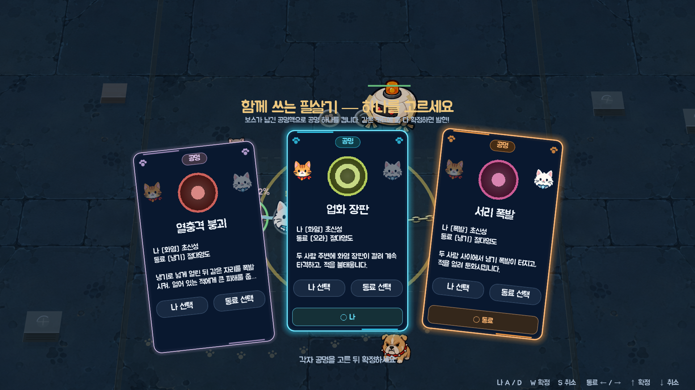

**이 화면은 성장 화면입니다.** 2026-09-18 이전에는 까맣게 덮인 화면 위에 글이 감긴 네모 창이 하나 떠 있었습니다 — 같은 순간(런이 멈추고, 두 사람이 카드를 보고, 지은 것이 바뀐다)인데 다른 게임의 메뉴처럼 읽혔고, 무엇보다 **그 선택의 대상인 두 고양이를 가렸습니다.** 지금은 말 그대로 같은 가구를 씁니다: 같은 띠 모양 패널, 같은 카드 부품(`growth_card_visual.gd`), 같은 부채꼴 배치, 같은 등장 연출과 카메라 당김, 그리고 **뒤에 멈춰 있는 전투가 그대로 비칩니다.** 두 사람이 같은 손패를 보므로 성장 화면의 "내 손패 / 동료 손패" 분리 대신 가운데에 부채 하나만 놓이고, 각자의 커서는 카드 아래 띠에 함께 그려집니다 — 성장 카드가 추천을 적는 바로 그 자리입니다. 누가 어디를 보고 있는지가 곧 그 카드에 대해 할 말의 전부이니까요.

**공명 슬롯은 2개**이고 런이 주는 핵도 정확히 2개입니다. 두 숫자를 같게 둔 것은 의도한 것입니다 — "공명은 몇 개까지?"의 답이 규칙이 아니라 두 사람이 직접 본 사건이 되도록. 공명 하나에 묶인 무기 칸은 HUD에서 **금색**으로 표시됩니다.

### 공명은 무기를 멈추지 않습니다

한때 공명을 켜면 그것을 만든 **양쪽 무기 한 자리씩이 침묵**했습니다. 칸과 레벨은 유지한 채 스스로 공격하지 않고, 공명이 그 자리에서 대신 공격했습니다 — 트리의 정점을 덧셈이 아니라 선택으로 만들려는 장치였습니다.

**2026-09-16에 그 침묵을 없앴습니다.** 공명을 만든 두 무기는 평소대로 계속 공격하고, 공명은 그 위에 얹힙니다. HUD의 무기 아이콘도 흐려지지 않고, 테두리의 쿨다운 고리는 언제나 **그 무기 자신의 다음 발사**를 가리킵니다.

공명의 위력은 **양쪽 주인의 공격력과 두 무기의 레벨**을 함께 먹습니다(레벨 1당 15%). **쿨다운은 공명마다 따로**이고 카탈로그에 적힌 숫자가 실제 숫자입니다 — 예전에는 활성화할 때 전체에 ×0.78이 곱해져서, 카탈로그가 말하는 값과 게임이 쓰는 값이 달랐습니다. 회복·탄 제거처럼 DPS로 잴 수 없는 유틸리티 공명은 같은 기준으로 매기지 않고 더 긴 쿨다운을 갖습니다.

한 무기는 여전히 **공명 하나에만** 쓰입니다.

### 일반 공명과 고유 공명

공명은 **속성 하나 + 행동 하나**를 요구합니다. 속성은 무엇으로 만들어졌는지(화염 · 냉기 · 뇌전 · 비전 · 그림자 · 성흔), 행동은 어떤 모양인지(탄막 · 참격 · 사슬 · 오라 · 유도 · 제어 · 폭발 · 폭풍 · 관통)를 말하고, **두 목록은 겹치지 않습니다** — 뇌전은 속성이고, 폭풍은 그 속성이 바닥을 덮는 방식입니다.

진화 무기는 **정확히 두 개의 태그**를 갖습니다(속성 1 + 행동 1). 예전에는 네 개씩이라 거의 모든 조합이 뭔가에 걸렸고, 그래서 공명은 빌드의 결과가 아니라 슬롯머신처럼 읽혔습니다.

공명 카탈로그는 두 층입니다.

| | 개수 | 만드는 방법 |
|---|---:|---|
| **고유 공명** | 24 | 두 태그가 함께 특별한 뜻을 갖는 조합만 손으로 작성 — 화염+냉기는 "냉기 장판에 화염 효과"가 아니라 **열충격**입니다 |
| **일반 공명** | 41 | 속성 × 행동에서 **자동 생성** — 행동이 모양(9종 템플릿)을, 속성이 색과 부가 효과를 정합니다 |

처리 순서는 `고유 공명이 있으면 그것을, 없으면 템플릿을`입니다. 이 구조 덕분에 **13번째 무기를 추가해도 기존 12개와의 공명을 하나씩 손으로 등록할 필요가 없습니다** — 태그 두 개만 주면 됩니다. 같은 이유로 커버리지가 구조적으로 보장됩니다: 진화 무기 A와 B는 항상 A의 속성과 B의 행동을 공급하고, 두 태그 목록이 겹치지 않으니 둘은 반드시 다르며, 양쪽이 각각 하나씩 낸 것이 됩니다.

### 공명은 설명대로 작동합니다

예전에는 공명 여러 개가 설명과 달리 **한 번의 즉발 타격**이었습니다 — "연속 타격한다"는 번개장은 한 번 쳤고, "유도 폭격"은 유도되지 않는 불씨였고, "끌어당긴 뒤 소멸"은 순간이동 후 즉시 피해였습니다. 지금은 지속 틱(런과 함께 멈추고 재시작 시 취소), 목표 선택, 착탄 시 효과로 설명을 그대로 구현합니다.

| 공명 | 실제 동작 |
|---|---|
| 추적 뇌광 | 가장 강한 적(보스 > 엘리트 > 체력)을 찾아 대형 연쇄 번개 + 재추적 2회 |
| 폭풍 유성군 | 두 사람이 각각 관통 탄막 + 자기 자리에서 낙뢰 |
| 마력 회로 | 사슬이 2.4초간 틱마다 태우고 두 사람 회복 |
| 열충격 붕괴 | 넓게 얼린 뒤 0.45초 후 같은 자리 폭발, 얼어 있는 적 ×1.6 |
| 폭풍 결계 | 두 사람 주변 번개장이 2.5초간 가까운 적 셋을 반복 타격 |
| 업화 초승달 | 양쪽 참격 + 베인 적 화상 3틱 |
| 빙결 족쇄 | 사슬 주변을 거의 멈추게 얼리고 2.7초간 결속 피해 |
| 혜성우 | 관통 얼음탄, 맞은 적 크게 둔화 |
| 성혼 궤적 | 유도 별탄이 착탄한 자리에 별빛 낙뢰가 떨어져 연쇄 |
| 폭풍의 핵 | 두 사람 사이의 핵이 네 방향 사분면으로 3회 연쇄 |
| 겁화 폭풍 | 화염탄 산개 후 0.5초 뒤 중심 폭발 |
| 절대영도 | 두 사람 주변 거의 정지 수준 빙결 + 얼어 있는 적 파쇄 틱 |
| 명월난무 | 큰 호 베기 후 반대 방향으로 한 번 더 |
| 결속의 진언 | 크게 회복 + 사슬 파동 3회, 사슬 위 적 탄 제거 |
| 유도 폭격 | 적이 가장 몰린 자리 네 곳을 골라 유도 불씨가 날아가 착탄 폭발(적이 하나뿐이면 네 발 모두 그 적에게) |
| 황혼 추적 | 강한 적 최대 5마리를 표시하고 그림자 낫이 따라가 급소(엘리트·보스 ×1.6) |
| 폭뢰 참월 | 참격 + 양쪽 낙뢰 + 감전 둔화 |
| 성화의 서약 | 회복 + 불길 + 주변 적 탄 정화, 1.5초간 지속 |
| 서리 그림자 | 참격이 지나간 부채꼴의 적을 얼림 |
| 특이점 | 0.48초간 실제로 끌어당긴 뒤 짓누르고 중심 소멸 |
| 참격 폭풍 | 여섯 갈래 심판, 매번 각도가 회전 |

성간 서약 · 명암의 계약 · 봉쇄 결계는 원래 설명대로 작동하고 있어 그대로 두었고, 월식의 사슬은 "거대한" 낫에 맞게 사거리·각도만 키웠습니다. 공명 투사체가 P2의 관통 수치를 빌려 쓰던 버그(주인 없는 시전의 `-1` 인덱스)도 고쳤습니다. `tests/resonance_mechanics_test.gd`가 지속·목표 선택·착탄·끌어당김·빙결·취소를 실제로 측정합니다.

강화 무기 12종의 **78가지 짝(동일 조합 포함) 전부**가 최소 하나의 공명을 갖는다는 것을 `tests/resonance_coverage_test.gd`와 `tests/weapon_data_test.gd`가 쌍별로 검사합니다. 진화를 둘 다 끝내고 "우리 조합은 공명이 없네"가 되는 일은 없습니다.

### 데이터 계약은 검사됩니다

이 시스템이 유저에게 하는 약속은 전부 **모양**에 대한 약속이고(무기마다 테크 둘, 테크마다 축 둘, 진화는 Lv.7, 태그는 둘, 모든 짝에 공명 하나), 그중 무엇도 타입 시스템이 지켜주지 않습니다. `tests/weapon_data_test.gd`가 대신 기계적으로 검사합니다 — 테크 모양과 역할, Primitive 이름, 진화 조건과 100% 계승, 태그 등록·개수·겹침, 78쌍 커버리지, 도달 불가능한 카탈로그 항목, 그리고 테크·진화·공명이 공유하는 **내부 ID(`TECH_*` · `EVOLUTION_*` · `RESONANCE_*`)의 전역 중복**까지. 여기서 실패하면 그것은 밸런스 의견이 아니라 데이터 입력 실수입니다.

---

## 생존자 12명

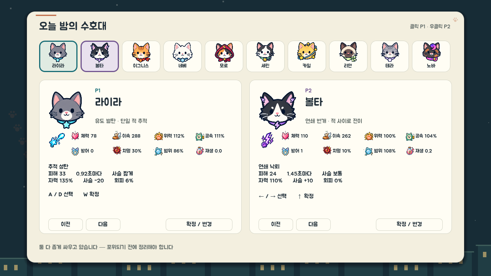

로스터는 예전에 **체력 92~115, 이속 205~242**가 전부였습니다. 25%와 18% 차이는 선택이 아니라 반올림 오차입니다. 지금은 체력·이속뿐 아니라 **위력, 범위, 발동 속도, 재생, 탄속, 추가 발사, 관통, 회피, 반사, 구조력**까지 캐릭터의 시작 능력으로 나뉩니다.

| 고양이 | 무기 | 체력 | 이속 | 위력 | 공속 | 범위 | 재생 | 특징 |
|---|---|---:|---:|---:|---:|---:|---:|---|
| 라이라 | 추적 성탄 | 89 | 288 | 112% | 111% | 86% | 0.0 | 치명 30%·회피 6% |
| 볼타 | 연쇄 낙뢰 | 112 | 262 | 100% | 104% | 108% | 0.2 | 균형형 연쇄 제어 |
| 이그니스 | 화염 성운 | 138 | 198 | 108% | 93% | 112% | 0.3 | 넓은 화염 살포 |
| 네베 | 빙결 고리 | 126 | 186 | 90% | 91% | 125% | 0.9 | 방어 4·상시 오라 |
| 모로 | 월식 낫 | 104 | 262 | 116% | 109% | 90% | 0.1 | 근접 치명·회피 |
| 세린 | 결속 파동 | 156 | 152 | 88% | 93% | 100% | 1.3 | 반사·구조·긴 사슬 |
| 카일 | 궤도 파편 | 129 | 214 | 94% | 109% | 112% | 0.3 | 시작 추가 발사 +1 |
| 리안 | 관통 광선 | 95 | 274 | 110% | 100% | 82% | 0.0 | 관통 +1·고속 탄환 |
| 테라 | 지뢰 결계 | 137 | 190 | 98% | 91% | 116% | 0.7 | 방어·구조·영구 지뢰 |
| 노바 | 중력 붕괴 | 127 | 240 | 100% | 95% | 120% | 0.2 | 적 군집 흡인 |
| 에코 | 생선 부메랑 | 101 | 255 | 106% | 102% | 95% | 0.1 | 세 번 지나가는 투사체 |
| 라떼 | 연유 흩뿌리기 | 121 | 190 | 96% | 96% | 112% | 0.7 | 지속 장판·감속 |

체력은 약 **1.75배**, 이속은 **1.9배** 벌어집니다. 라이라는 최고 속도와 최고 치명률을 가진 대신 로스터에서 가장 얇고, 세린은 가장 높은 체력과 가장 느린 이동 속도를 가집니다. **자력은 더 이상 시작 무기나 캐릭터의 숨은 예산이 아닙니다.** 모든 캐릭터가 같은 100%에서 시작하고, 보물과 영구 성장으로만 올립니다. **사슬**은 위에서 본 그 밧줄 길이입니다.

무기는 생존자당 **4칸**입니다(보물과 같은 이유로 6에서 돌아왔습니다 — [보물](#보물)). 시작 무기 하나로 출발해 `신규 무기` 카드로 다른 고양이의 무기를 습득할 수 있습니다. 교체는 없고 추가만 됩니다. 습득한 무기는 원래 주인의 색과 태그를 그대로 가져오고, 각자 독립된 쿨다운으로 발동합니다.

**같은 무기를 두 번 가질 수는 없습니다.** 오래 있던 버그 하나가 정확히 그걸 허용했습니다: 강화는 칸의 이름을 바꿉니다 — 들고 다니던 `유도탄`이 `성좌 관통포`가 되면서 `base_weapon_id`만 남기고 예전 `weapon_id`를 잃습니다. 그런데 "이 생존자가 안 가진 무기"를 고르는 쪽이 `weapon_id`를 보고 있었으므로, **무기가 강화되는 순간** 레벨업 손패와 상자가 그 기본형을 `신규 무기`로 다시 내놓기 시작했습니다. 집으면 같은 무기가 두 칸을 먹었습니다 — 하나는 강화형, 하나는 Lv.1. 보유 판정은 이제 `base_weapon_id`를 읽고, 그와 별개로 **칸을 실제로 쓰는 자리에서도** 한 번 더 막습니다(손패가 뽑힌 뒤 상자가 먼저 들어오는 등 낡은 카드가 도착할 수 있는 경로가 있으므로). 낡은 카드는 버려지지 않고 **이미 가진 그 무기의 레벨 한 단계**로 바뀝니다. 보물도 같은 규칙입니다.

### 선택 화면에서 성장 경로까지 보여줍니다

고양이는 **품종 한 줄로 소개됩니다** — `별을 쫓는 러시안블루`, `우유를 나르는 노르웨이숲`. 초기 열 마리는 무기 설명으로, 뒤에 합류한 두 마리는 품종으로 소개되던 불일치를 없애 모두 같은 문법으로 맞췄습니다. 무기가 무엇을 하는지는 카드 아래 블록과 레벨업 카드가 계속 말해줍니다.

쉬움/보통/어려움 등급은 제거했습니다. 대신 시작 무기 아이콘, 8개 핵심 수치, 각 테크와 필요한 보물, 최종 무기를 한 카드에서 비교합니다. 아래 조합 문구는 두 캐릭터의 커버리지와 내구를 계산해 협동 시 주의점을 알려줍니다.

---

## 옥상의 불청객

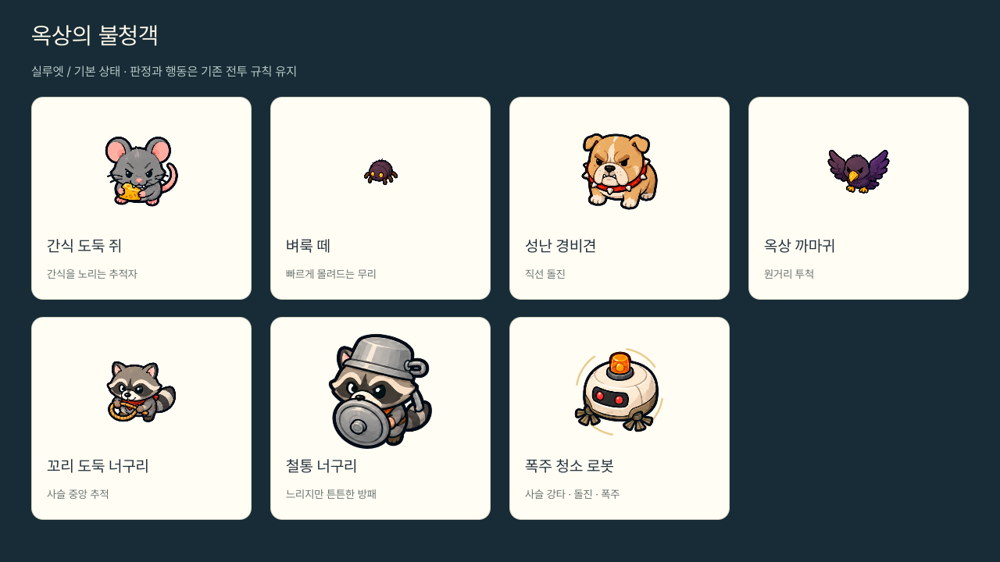

| 적 | 성격 | 등장 |
|---|---|---|
| **간식 도둑 쥐** | 가장 가까운 고양이를 추적 | 0:00 |
| **성난 경비견** | 주기적으로 고속 돌진 | 0:30 |
| **옥상 까마귀** | 거리를 유지하며 투척 | 0:36 |
| **벼룩 떼** | 체력 10 · 속도 128 — 22초마다 **7마리 이상이 한꺼번에**. 체력당 경험치가 쥐의 두 배라 파밍 구간이 됩니다 | 0:45 |
| **꼬리 도둑 너구리** | 고양이가 아니라 **사슬**을 뜯습니다 | 0:55 |
| **철통 너구리** | 체력 190 · 속도 44 — 빨리 죽지 않고 그동안 사슬로 곧장 걸어옵니다. 화력을 쓸지 피할지 고르게 만듭니다 | 1:15 |
| **청소 로봇 계열** | 보스 5체. 사슬에서 가장 가까운 지점을 노리는 **사슬 강타**로 내구도를 직접 태웁니다. 격노하면 빨라지고 돌진까지 씁니다 | 5:00부터 5분마다 |

보스의 원형 강타는 **1.5초 예고**(격노 시 1.1초)합니다. 안쪽 원이 차오르고 바깥에 진행 호가 돌아서 **어디**만이 아니라 **언제**를 보고 피할 수 있습니다. 0.7초였던 시절에는 회피가 아니라 반응 속도 시험이었습니다.

---

## 경험치는 모든 적이 떨굽니다

**모든 적이 자기 보석을 남깁니다.** 예전에는 잡몹의 경험치가 공용 은행에 쌓였다가 모일 때만 보석 하나로 나왔는데, 그러면 한 판 킬의 대부분이 볼 것을 남기지 않았습니다 — 벼룩 떼를 정리한 보상이 화면 밖 숫자가 움직이는 것뿐이었죠.

구분은 **보석의 등급**이 합니다. 등급은 두 가지를 함께 말합니다.

| | 초반 | 9분 이후 |
|---|---|---|
| 벼룩 떼 · 간식 도둑 쥐 | 0 (모트) | 1 (파편) |
| 경비견 · 까마귀 · 너구리 | 1 (파편) | 2 (프리즘) |
| 철통 너구리 | 2 (프리즘) | 2 |
| 정예 | 2 | **3 (코어)** |
| 보스 | **3** | **3** |

예전에는 등급을 절대 경험치 값으로 정했는데, 경험치가 난이도당 20%씩 오르므로 20분쯤이면 쥐 한 마리가 1분의 철통 너구리와 같은 문턱을 넘어 네 등급이 아무것도 구분하지 못했습니다. 최상위 등급은 정예와 보스에게 남겨두어, 바닥에서 그것을 발견하는 일이 의미를 갖게 했습니다.

떨어지는 자리에 이미 보석이 있으면 **합쳐집니다**(46px 이내, 화면 동시 320개 상한). 경험치는 사라지지 않고 그 보석이 무거워지고 밝아질 뿐입니다. 이게 없으면 자동 플레이 15분에 **1,987개**가 바닥에 깔리고 계속 늘었습니다.

---

## 필드 아이템

필드 아이템은 **정예와 보스만** 남깁니다(최종 보스 제외 — 쓰러뜨리는 순간 판이 끝납니다). 예전에는 평범한 잡몹도 1.5%로 굴렸는데, 한 판에 육천 마리를 잡는 게임에서 그건 관대함이 아니라 잡음입니다 — 아무 데서나 꾸준히 떨어지니 가지러 갈지 말지가 결정이 되지 않고, 결국 바닥을 아예 안 읽게 됩니다. 이제 잡몹은 **경험치만** 떨굽니다. 드랍은 이름이 붙은 싸움이 남긴 것이고, 그래야 "저기 뭐 떨어졌다"가 군중을 가로지를 값어치가 있습니다.

경험치 보석과 달리 **필드 아이템은 끌려오지 않습니다.** 직접 밟아야 합니다 — 가지러 갈지 말지를 사슬을 당겨가며 정하는 것이 이 드랍의 존재 이유입니다. 효과는 주운 사람이 아니라 **둘 다**에게 적용됩니다. 22초 뒤 사라지고, 마지막 5초는 깜빡입니다.

**화면 밖 드랍은 화면 가장자리에 표시됩니다.** 정예·보스를 가리키는 위협 표시와 같은 방식으로, 같은 자리에 금색으로 `상자 34m`처럼 방향과 거리를 띄웁니다. 드랍은 이름 붙은 싸움만 남기는 데다 22초면 사라지고, 그 싸움이 끝난 자리는 보통 화면 밖이니 — 있는 줄도 모르고 놓치는 일이 없어야 합니다. 남은 시간이 9초 아래로 떨어지면 `상자 34m 6초`로 초읽기가 붙고, 마지막 5초에는 바닥의 드랍과 **같은 박자로** 깜빡입니다. 상자는 다른 드랍보다 항상 우선합니다 — 참치캔이 더 가깝다고 카드 세 장을 양보할 이유는 없습니다. 위협 표시와 같은 방향에 겹치면 드랍 쪽이 비켜섭니다.

| 아이템 | 효과 |
|---|---|
| 🍚 **결속의 양식** | 둘 다 최대 체력의 30% 회복 |
| 🧲 **자력 파동** | **맵 전체의 경험치 보석이 날아옵니다.** 거리와 무관하게 약 1초에 걸쳐 스트림처럼 도착합니다 |
| 🔗 **사슬 결계** | **8초간 사슬 무적.** 내구도가 닳지 않고, 과부하가 풀리고, 어떻게 서 있든 과충전 보너스(+25%)를 받고, 사슬에 닿는 적이 0.22초마다 탑니다 |
| 🔔 **수호의 방울** | **5초간 두 사람 완전 무적.** 창이 도는 동안은 무엇도 들어오지 않습니다 |
| 🌿 **광란의 마타타비** | **8초간 피해 +80%.** 모든 무기가 같이 세집니다 |
| ⏱️ **멈춘 회중시계** | **4초간 시간 정지.** 적도, 이미 날아오던 탄도 멈춥니다 |
| 💥 **정화의 불꽃** | 넓은 범위 강타 — 팽창하는 충격파, 중심 백색 섬광, 16갈래 방사선 |

넷이던 드랍이 **일곱**이 됐습니다. 스무 번 남짓 줍는 한 판에서 네 종류는 곧 같은 것의 반복이고, 줍는 순간이 질문("뭐 나왔어?")이 아니라 절차가 됩니다. 새로 들어온 셋은 전부 **즉발이 아니라 창**입니다 — 언제 쓸지를 고르게 만드는 쪽이, 걸어가서 밟을 값어치가 있습니다.

`사슬 결계`는 원래 `사슬 정비`였고, 하는 일은 내구도 게이지를 45 채우는 것뿐이었습니다. 게이지가 오르는 건 사건이 아닙니다. 지금은 환급이 아니라 **창**입니다 — 8초 동안 사슬 경제가 통째로 멈추고, 그 사이 사슬 자체가 무기가 됩니다. 언제 주울지가 결정이 됩니다.

### 수염 상자

가장 좋은 드랍은 **정예와 보스에게서만** 나옵니다. 예전에는 평범한 잡몹도 0.4%로 굴렸는데, 한 판에 육천 마리를 잡는 게임에서 그건 뒤에서 조용히 돌아가는 슬롯머신입니다 — 실제로 상자 대부분이 거기서 나왔고, 그래서 상자는 **아무 데서나 늘 나오는 것**이 됐습니다. 지금은 정예를 잡으면 34%(행운으로 최대 70%), 보스는 격파할 때마다 확정으로 하나입니다. 이겨야 했던 싸움에서만 나옵니다.

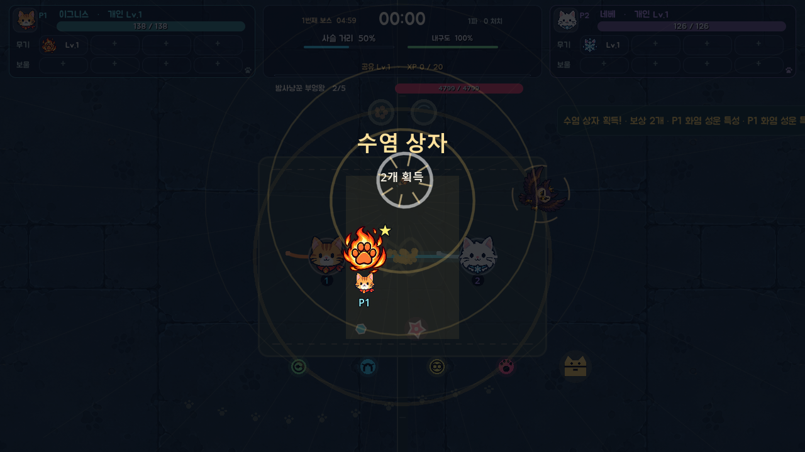

여는 것도 사건입니다. 상자가 점점 세게 흔들리다가 이음새에서 빛이 새고, 터지면서 18갈래 광선이 뻗고, 보상이 **최소 두 개**, 하나씩 차례로 튀어나옵니다. 한꺼번에 보여주면 그건 목록이지 상자가 아닙니다.

---

상자는 버티다가 터집니다. 떨다가 웅크리고 튀어올라 뚜껑이 날아가고, 동전과 색종이가 쏟아지고, 카드는 뒷면으로 던져져 공중에서 뒤집힌 뒤 제자리에 착지합니다. 전투도 같은 박자를 따릅니다 — 공격이 나갈 때 고양이가 부풀고(진화 무기는 더 크게), 적중 불꽃은 맞힌 무기의 색이며, 처치하면 잔해가 튀어 옥상에 떨어집니다. 자세한 내용은 [연출 강화](docs/vfx-motion-2026-09-22.md)에 있습니다.

## 끝없는 옥상

옥상에는 **끝이 없습니다.** 예전에는 ±2400px 고정 판이라 화면 네 개 남짓이었고, 한 방향으로 카이팅하면 세계 밖으로 나갔습니다.

판을 키우는 대신(가장자리를 옮길 뿐입니다) 바닥이 **카메라를 따라다니며 다시 그리고, 내용을 월드 좌표에서 생성**합니다.

- 포장은 타일 좌표의 **순수 함수** — 저장할 필요 없이 무한히 반복됩니다
- 장식은 **셀 좌표 해시**로 배치됩니다(`RoofLayout`). 같은 자리는 몇 번을 지나도 같은 물탱크와 빨래줄입니다

끝이 없으면서도 노이즈가 아닌, 배울 수 있는 장소입니다. 카메라가 384px을 넘길 때만 재구축하므로 비용도 고정입니다.

### 서 있는 옥상

장식은 낱개가 아니라 **장면**으로 놓입니다 — 빨래줄과 우유 상자, 파라솔 탁자와 화분, 실외기 둘과 터빈 환풍기를 잇는 바닥 전선관, 전구줄 아래 벤치. 서 있는 소품 19종(물탱크·굴뚝·안테나·화분 나무·고양이 집·생선 건조대 …)과 바닥 장식 10종(달이 비치는 웅덩이·이끼·낙엽·금·분필 그림·발자국 …)이 있고, 시작 화면은 급식 테라스를 둘러싼 손배치입니다.

소품은 **실제로 서 있습니다.** 고양이·적과 같은 y 정렬 무대에 발밑 기준으로 들어가므로, 뒤에 선 고양이는 물탱크에 가려지고 앞에 선 고양이는 물탱크를 가립니다. 예전처럼 가까이 가면 사라지지 않습니다. 예외는 둘뿐입니다 — 키 큰 소품이 생존자를 실제로 가리면 0.8까지만 옅어지고 고양이 윤곽이 그 위에 그려지며, 떨어진 아이템을 덮으면 0.45까지 옅어집니다.

장식은 이동을 막지 않으므로, **키 큰 것은 아래가 비어 있고 꽉 찬 것은 낮게** 만들었습니다(기둥 위 물탱크, 갓 아래 파라솔, 높은 수관의 나무). 빨래·나무·연기는 옥상 하나의 바람에 함께 흔들리고, 팬이 돌고, 전구와 안테나 경고등과 고양이 집 안의 눈이 깜빡입니다. 막지는 않지만 **부딪히면 대답합니다** — 걷거나 대시해 지나가면 소품이 밑동을 축으로 흔들리고, 빨래가 펄럭이고, 잎이 떨어지고, 고양이 집의 눈이 숨습니다. 충격파와 보스의 사슬 강타는 주변 소품을 한꺼번에 흔듭니다. 드랍·경험치 보석·보급 화분은 소품 안이나 뒤에 생기지 않도록 가장 가까운 빈 바닥으로 옮겨집니다. 자세한 내용은 [옥상 장식](docs/roof-decor-2026-09-22.md)에 있습니다.

### 달빛 옥상

옥상에는 **광원이 하나뿐이고, 왼쪽 위에 있습니다.** 예전에는 표면마다 빛이 어디서 오는지에 대한 생각이 달랐습니다 — 상자는 그림자를 오른쪽 아래로 6px, 환풍구는 다른 6px, 털실은 5px 던졌고, 고양이와 적은 아예 던지지 않았습니다. 그래서 옥상이 하늘 아래 선 장소가 아니라 색 도형을 늘어놓은 판으로 읽혔습니다. 지금은 바닥을 그리는 모든 것이 `scripts/systems/moonlight.gd` 하나에게 빛의 방향과 그 아래에서의 표면 색, 그림자의 모양을 물어봅니다.

규칙은 두 가지입니다.

**바닥은 명도와 채도를 잃고, 행위자는 잃지 않습니다.** 화면 전체를 어둡게 하는 것이 밤을 만드는 뻔한 방법이자 여기서는 틀린 방법입니다 — 어두운 옥상에 잠긴 적은 아무도 피하지 않는 적입니다. 그래서 그레이드는 바닥과 소품에만 적용되고 생존자·적·공격 예고는 설계된 대비를 그대로 유지합니다. 채널별 곱셈으로 식히던 초안은 파랑을 올리고 빨강을 내려서 나무 상자를 정확히 무채색 회색으로 만들어버렸습니다. 지금은 같은 밝기의 달빛 색으로 **일정 비율만 끌어당겨서**, 모든 표면을 똑같이 식히되 표면들 사이의 차이는 남깁니다.

**장면에 더해지는 빛은 자기 레이어에 그리고, 이펙트 전체에 블렌드 모드를 거는 일은 없습니다.** Additive를 몸체에 걸면 검은 외곽선과 그늘진 면이 사라지고, 캐스트가 몇 개만 겹쳐도 여덟 번의 공격이 하나의 흰 덩어리가 됩니다. 그래서 이펙트는 몸체를 평범하게 그리고, 실제로 발광하는 부분만 `GlowLayer`(공유 additive 재질)에 넘깁니다 — 번개는 선명한 심과 그 뒤로 번지는 빛, 불꽃은 주황색 몸체와 뜨거운 심지, 사슬은 몸체와 그 위를 흐르는 빛.

그 흐르는 빛이 `ChainFlow`입니다. 사슬은 이 게임에만 있는 것이므로 가장 기억에 남아야 하고, 그것이 말하는 바는 **빛이 어느 쪽으로 얼마나 빠르게 가는지**로 전달됩니다 — 곁눈으로도 읽히니까요. 평상시에는 느린 한 줄기, 과충전에서는 두 고양이 사이를 오가는 흐름이 빨라지고, 한계에서는 팽팽하게 떨리며 연결부가 불꽃을 튀기고, 공명이 터지면 양쪽에서 모인 빛이 사슬 전체로 퍼집니다. 색과 절대 어긋나지 않도록, 흐름은 사슬 색을 고르는 것과 **같은 장력 단계**를 받습니다.

그리고 **무기가 옥상을 실제로 비춥니다.** 이펙트 위에 후광을 덧그리는 것과, 그 공격이 주변을
밝히는 것은 서로 다른 기법입니다 — 앞의 것은 "저게 밝다"고 말하고, 뒤의 것은 "옥상이 밝은
무언가 옆에 서 있다"고 말합니다. 로스터 24종이 전부 `WeaponController.CAST_LIGHT` 표에 따라
바닥에 빛을 던지고(`scripts/effects/light_field.gd`), 냉기 오라·우유 웅덩이·중력장·사슬은
사건이 아니라 **조건**이라서 자기 노드에 광원을 달고 그것과 함께 삽니다.

세 가지가 규칙입니다. **연사 무기는 아주 약하게, 드물게 터지는 것은 세게** — 같게 주면 옥상이
고른 밝기로 떠오르고 아무것도 사건으로 읽히지 않습니다(유도 0.07, 초신성 0.26). **동시에 14개가
상한**이고, 자리가 없으면 *가장 약한* 빛이 밀려납니다 — 연사의 맥동이 공명에 자리를 내주지 그
반대가 되면 안 되니까요. 그리고 **중력장과 과부하된 사슬은 빛을 뺍니다**(`BLEND_MODE_SUB`) —
게임에서 유일하게 빛을 빼는 것이라 붕괴로 읽힙니다. 과충전(+25%)에서는 반대로 밧줄 아래
옥상이 실제로 밝아집니다. 이 게임의 핵심 거래는 밧줄을 보고 있어야만 읽히면 안 됩니다.

같은 방식으로 `tests/weapon_light_capture.gd`가 네 장면을 켜기/끄기로 찍습니다. 효과 자체가
아니라 **효과 주변**을 프레이밍합니다 — 실제 빛은 이펙트의 경계에서 멈추지 않으므로, 예산이
높으면 밝아 보이는 데 그치지 않고 적이 바닥에 묻힙니다. 자세한 수치는
[무기 광원 · 투사체 병목 · 렌더링 누락](docs/lights-and-projectiles-2026-09-16.md)에 있습니다.

연출 전체는 `F12` 한 키에 걸려 있습니다. 조명 변경이 도움이 됐는지 아는 유일한 방법은 같은 장면을 켠 채와 끈 채로 보는 것이고, 그것을 판정하는 장면은 적 이백 마리가 깔린 20분짜리 장면이라 두 번 만들 수 있는 것이 아니기 때문입니다. `tests/moonlight_capture.gd`가 같은 씨앗으로 네 장면(조용한 옥상 · 소품 · 사슬 한계 · 밀집)을 켜기/끄기로 찍습니다. 저장하지 않는 것은 의도한 것입니다 — 이것은 취향이 아니라 계측기이고, 취향이라면 일시정지 메뉴에 줄을 얻어야 합니다.

---

## 전투 HUD

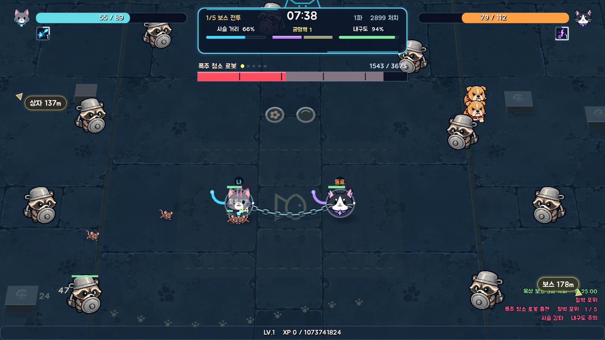

**상단 공용 바는 세 칸입니다.** 사슬 거리 · 공명 · 내구도가 같은 폭, 같은 모양으로 놓입니다. 예전에는 미터가 둘이고 그 옆에 `공명 1/3`이라는 **맨 문자열**이 하나 붙어 있었습니다 — 눈이 이미 "여기는 막대가 오는 자리"로 학습한 줄에서, 셋 중 하나만 읽어야 하는 값이었던 셈입니다. 공명은 이제 **칸**으로 그려집니다(`scripts/ui/resonance_pips.gd`): 활성 공명은 채워진 보라 칸, 아직 쓰지 않은 **공명핵은 금색으로 맥박치는 빈 칸**입니다. 쓰지 않은 핵은 두 사람이 자신에게 빚진 결정이므로, 지나가는 알림 한 줄이 아니라 셈 옆에 계속 남습니다.

공용 바가 쓴 고양이 귀 장식이 화면 위로 잘려 있던 것도 고쳤습니다(패널을 y=8 → 16). HUD가 잘린 것처럼 보이는 것과 장식인 것은 다릅니다.

**보스 체력바는 직접 그립니다**(`scripts/ui/boss_health_bar.gd`). 예전에는 `ProgressBar`에 숫자를 얹은 것이었고, 그건 사슬 미터와 경험치 바가 쓰는 바로 그 위젯입니다 — 런 전체가 그를 중심으로 짜인 유일한 적이 **수동 스탯과 똑같은 시각 언어로** 자기를 알리고 있었습니다. 지금 네 가지를 더 말합니다.

| | 무엇을 | 왜 |
|---|---|---|
| **잔상** | 큰 피해가 들어가면 붉은 막대는 즉시 떨어지고 창백한 막대가 0.5초 동안 따라옴 | "방금 그거 얼마나 들어갔지"는 보스전에서 실제로 묻는 질문이고, 미끄러지는 모서리 하나로는 답할 수 없습니다 |
| **구간 눈금** | 다섯 칸으로 나눈 트랙 | "4분의 1 남았다"를 두 숫자에서 계산하지 않고 보게 |
| **순번 점** | 이름 옆에 다섯 중 몇 번째인지 | 별도 라벨의 `2/5`를 읽지 않게 |
| **격노 상태** | 절반을 넘기면 더 뜨거운 색과 느린 맥박 | 격노는 싸우는 법을 바꾸므로 바도 바뀝니다 |

이름이 길어도 순번 점을 뚫지 않도록, 점은 가운데가 아니라 **이름이 끝난 자리부터** 놓습니다.

**화면 가장자리 표시는 실제로 가리킵니다**(`scripts/ui/edge_pointer.gd`). 상자와 정예/보스 두 마크는 어두운 사각형에 글자를 얹은 `Label`이었고, 위치에만 방향이 담겨 있었습니다 — HUD에서 가장 급한 두 읽기(**어느 쪽**, **얼마나 멀리**)를 단어와 숫자가 통째로 지고 있었던 셈입니다. 가리키지 않는 포인터는 캡션입니다. 지금은 방위 위에 **화살촉**이 서고, 알약은 자기 글자 길이에 맞춰 늘어나며, 가까워질수록 화살이 커지고 알약이 밝아집니다. 사라지기 직전의 드랍은 맥박칩니다. 둘은 같은 클래스에 색만 다르므로 **한 종류의 마크**로 읽힙니다.

`tests/hud_capture.gd`가 이 셋을 한 프레임에 찍습니다 — 보스가 화면 밖에 있고, 상자가 반대쪽에 있고, 공명 하나가 켜진 채 핵 하나가 남은 상태로.

---

## 설계 노트

몇 가지는 "왜 이렇게 했는가"가 규칙 자체보다 중요합니다.

**레벨업은 연달아 열리지 않습니다.** 경험치는 뭉텅이로 들어옵니다(벼룩 떼, 자력 파동). 여러 레벨이 동시에 차면 화면이 연달아 열려 *멈춤 → 한 프레임 → 멈춤*이 됐습니다. 지금은 1.1초를 기다린 뒤 열리고, 그 대기는 **런 시간으로 소모**되므로 텀이 정지가 아니라 플레이로 돌아옵니다. 밀린 레벨은 사라지지 않습니다.

**모든 화면은 하나의 그리드 위에 있습니다.** 1280×720을 12칸 × 8줄로 나누고(여백 48/40, 칸 84×66, 간격 16) 모든 패널과 글자를 거기에 맞춥니다. 페이지를 다 쓰는 화면(제목·로비·캐릭터 선택·성장)은 12칸, 대화에 가까운 화면(일시정지·결과)은 가운데 8칸을 씁니다. 일시정지는 전체 폭의 계속하기, 2×2 설정, 하단 실행 버튼으로 정렬됩니다. `scripts/ui/layout_grid.gd`가 좌표를 계산하고, `tests/layout_test.gd`가 제목 하위 화면과 확인창까지 삐져나옴과 잘림을 기계적으로 검사합니다.

**빌드는 전투 화면에 있습니다.** 예전에는 화면 구석에 무기 아이콘 네 개만 있었습니다 — 보물은 아예 보이지 않았고, 갓 얻은 무기와 다 키운 무기를 구별할 방법도 없어서, 자기 빌드를 보려면 메뉴를 열어야 했습니다. 지금은 생존자마다 두 줄(무기 / 보물)이고, 아이콘마다 **레벨 숫자**가 모서리에 겹쳐 붙습니다 — 판때기 없이 숫자만, 외곽선으로만 읽히게. `T3`은 계급표처럼 읽히지 자란 것처럼 읽히지 않아서, 게임 안 어디에도 남겨두지 않았습니다.

**보물 강화 · 공명 · 상자는 화면을 가져갑니다.** 셋 다 예전에는 메시지 배너 한 줄로 끝났습니다 — 나머지 마흔 장의 "+25% 피해"와 **똑같은 무게**로. 트리에서 가장 큰 사건이 화면에서 가장 작은 사건이었던 셈입니다. 지금은 2초 남짓 런을 멈추고 각자 다른 **모양**으로 재생됩니다. 색만 다른 같은 애니메이션이면 안 하느니만 못하니, 방을 가로질러 봐도 무엇이 일어났는지 알 수 있게 셋의 문법을 다르게 잡았습니다.

| | 모양 | 왜 |
|---|---|---|
| **보물 강화** | 무기와 보물이 안쪽으로 모여 **강화 무기**가 됨 · 섬광 한 번 | 장비 둘의 힘이 결속되는 일이니까 |
| **공명** | 둘이 **둘로 남아** 마주 보고 공전 · 파동이 계속 바깥으로 | 한 마리의 무기가 아니라 **둘의 기술**이니까 |
| **상자** | 버티다 터지고 **하나씩** 튀어나옴 | 뭐가 나올지 모르는 게 상자니까 |

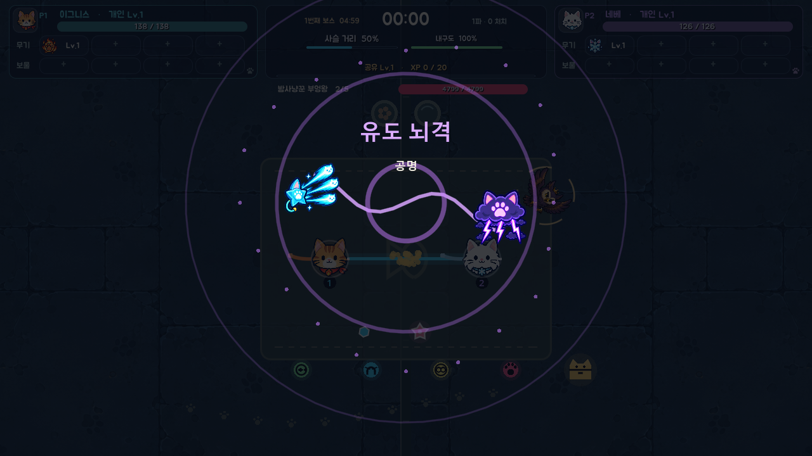

연출 노드는 `PROCESS_MODE_ALWAYS`로 돌고 자기 시계만 봅니다. 레벨업처럼 이미 정지된 상태에서든, 전투 중 상자를 밟았을 때든 똑같이 재생되고, 게임 상태에는 아무것도 하지 않습니다 — 런을 멈추고 되돌려주는 일은 전부 `main`이 합니다.

**투사체는 점이 아닙니다.** 유도 별탄과 불꽃 투사체는 꼬리 달린 원 하나였고, 그려지는 낫 궤적이나 궤도 링 옆에 놓으면 자리표시자처럼 보였습니다. 지금은 별탄이 **네 갈래 별에 테이퍼드 꼬리와 흩어지는 불꽃**, 불씨가 **속심이 밝은 물방울**이고 발사할 때마다 다른 씨앗으로 실루엣이 흔들립니다. 결계 지뢰도 원 두 개에서 **여섯 마디 룬 고리와 겹삼각 문양**이 됐습니다. 전부 로컬 좌표에 한 번만 그리고 노드의 회전·스케일·모듈레이트로 움직이므로, 삼백 개가 날아다녀도 비용은 예전의 원 하나와 같습니다.

**공격 이펙트는 잠깐 머문 뒤 사라집니다.** 예전엔 나타나는 즉시 0.12~0.22초 직선 페이드였는데, 그 시간의 절반이 50% 불투명도 아래라 초당 한 번 쏘는 무기가 타격이 아니라 옅은 얼룩으로 보였습니다. 화면에 쓰는 총 시간은 그대로 두고 **눈에 들어오는 구간을 최대 불투명도**로 옮겼습니다.

**아군 링과 적 예고는 밝기가 아니라 지속 시간으로 구분됩니다.** 아군 링은 0.31초면 사라지고, 적 예고는 1초 이상 차오릅니다. 그렇게 빨리 사라지는 것은 피해야 할 것으로 오인될 수 없으므로, 링은 얼마든지 밝아도 됩니다.

**생존자는 축별 밴드가 아니라 하나의 총예산으로 묶여 있습니다.** 축마다 밴드를 두는 방식이 바로 로스터를 납작하게 만든 원인이었습니다 — 모든 축에서 평범해야 통과하니까요. 지금은 어느 축에서든 극단적이어도 되고, 대신 **다른 데서 값을 치러야** 합니다.

```
defense  = 체력/100 + 방어×0.10
mobility = 이속/230 + 사슬/700
offense  = 피해/쿨다운 × reach / 34 × (1 + 치명×1.5)
utility  = 0.32 (공통 경제 기준)
```

`reach`는 한 번의 발동이 실제로 얼마나 적중하는지를 무기별로 적어둔 값입니다. 이게 없으면 오라계 무기는 쓸모없어 보이고 근접 무기는 사기처럼 보입니다.

네 값의 **합**이 3.90~4.00 안에 들어야 `tests/survivor_balance_test.gd`를 통과합니다. 그리고 예산만으로는 **똑같은 고양이 열두 마리도 완벽히 만족**하므로, 같은 테스트가 축별 **최소 분산**을 따로 검사합니다. 로스터를 다시 납작하게 만들면 거기서 걸립니다.

**대군 렉은 시뮬레이션과 렌더 제출 양쪽의 문제였습니다.** 적은 `CharacterBody2D`끼리 충돌시키는 구조가 아니라 직접 이동·공간 분할하고, 화면에는 군중 전체를 개별 노드가 아니라 런타임 아틀라스와 `MultiMesh` 깊이 밴드로 제출합니다. 현재는 다음처럼 상한을 둡니다.

- 화면 안 일반 적 AI는 2개 배치, 화면 밖은 6개 배치로 나누되 보스와 공격 예고는 매 틱 갱신합니다.
- 군중 분리는 평면 배열과 제한된 이웃 표본만 사용해 매 프레임 비용을 선형으로 유지합니다.
- 공간 분할 셀 배열을 매 프레임 새로 만들지 않고 재사용합니다.
- 감속을 걸 때 적마다 `Tween`을 만들지 않고 타이머와 색만 갱신합니다.
- 경험치 보석은 320개로 병합하며, 병합 전에 노드를 만들던 누수를 제거했습니다. 1,000회 병합에서도 자식 노드 수가 늘지 않습니다.
- 군중 아틀라스는 밉맵을 만들지 않고 nearest 필터를 고정해 이동·줌 중 해상도 단계 전환으로 적이 깜빡이지 않게 합니다.
- 24px 깊이 밴드는 실제 사용량에 가까운 2의 거듭제곱 버퍼만 유지합니다. 빈 밴드가 128개 슬롯을 매 프레임 업로드하던 낭비를 제거했습니다.

620마리의 최근 로컬 헤드리스 측정은 물리 틱 약 **3.12ms**, 군중 렌더 준비 약 **1.08ms**입니다. 렌더 준비 시 활성 깊이 밴드는 42개, 밴드 버퍼는 총 1,016슬롯이며, 종전 최소 할당 규칙의 약 1만 슬롯보다 크게 줄었습니다. 헤드리스 수치는 실제 GPU 프레임 시간이 아니라 변경 전후 CPU 비교 지표입니다.

2026-09-21 로컬 창 렌더 벤치(`perf_bench_capture.gd`)에서 현재 상한인 1,240마리와 진화 무기 8정을 채우면 실제 진행 프레임은 **p50 11.23ms, p90 33.26ms, p99 70.21ms**였습니다. 화면을 고정한 렌더 측정은 p50 3.13ms, p90 3.92ms였습니다. 같은 조건에서 우유 장판 처리 3.07ms/물리 틱, 적 피격 처리 3.47ms/물리 틱이 주요 비용이었습니다. 따라서 최대 군중에서 프레임 지연을 줄이는 작업이 남아 있습니다. 이 수치는 해당 PC의 비교 지표이며 다른 기기의 프레임률 보장은 아닙니다.

**방향 전환은 프레임을 두고 돕니다.** 예전에는 그려지는 방향이 다음 프레임에 그냥 교체돼서, 고양이가 도는 게 아니라 스프라이트가 좌우 반전으로 바뀌는 것처럼 보였습니다. 지금은 그리기용 방향만 몇 프레임에 걸쳐 따라가고, 도는 각속도가 몸의 기울기와 꼬리의 채찍질을 만듭니다. **입력 자체는 여전히 즉시 반영됩니다** — 조작이 미끄러지면 안 되니까요.

**발밑 먼지·타격 불꽃·대시 잔상**은 전부 `ParticleField` 한 노드가 한 번의 `_draw()`로 그립니다. `BurstField`(사망 파섬)와 같은 이유입니다 — 초당 수백 개의 이벤트에 노드와 트윈을 하나씩 붙이면 그건 연출이 아니라 스톨입니다. 이쪽은 그보다 더 강하게 상한을 두고(260개) 0.3초 이상 살지 않으며, 부하가 걸리면 **먼저 버려지는 것이 맞습니다.** 게임에는 아무 영향도 주지 않고, `motion_test`가 그걸 검사합니다.

**효과음과 음악은 외부 샘플 없이 합성합니다.** 효과음은 캐시와 최대 10개 보이스를 사용하며, 사슬 과부하·복구, 동료 다운·부활, 피격, 구매·확정·취소를 구분합니다. 중요한 경고가 나오면 일반 전투음과 음악을 잠시 낮추며, 동료 신호와 보스 예고에는 화면 기준 좌우 방향감을 줍니다. 전투 BGM은 96 BPM·80초 A/B 구성으로 일반·달빛·후반 변주·보스·격노를 포함합니다. 타이틀은 40초 루프, 승리와 패배는 각각 10초짜리 마무리 음악입니다. `python tools/generate_music.py`로 WAV를 재생성할 수 있습니다. 볼륨은 버스에 즉시 적용하고 음악 재생 위치를 유지합니다.

### 주요 시스템

| 클래스 | 역할 |
|---|---|
| `WaveDirector` | 파 진행, 보스 5체 스케줄, 이름 붙은 조우, 적 풀링 |
| `WeaponController` | 무기 24종(기본 12 + 진화 12), 고유 공명 24종 + 일반 공명 템플릿 9종, 투사체 풀링 |
| `ResonanceSystem` | 태그 조건, 카탈로그 생성(고유 24 + 일반 41), 공명핵, 후보 생성, 활성 공명 쿨다운 |
| `WeaponTechCatalog` | 무기별 테크 둘(A 화력 / B 속도), 공격 방식, 추천 보물, 내부 ID |
| `EvolutionCatalog` | 무기+보물 강화 조건과 강화 무기 정의 |
| `TreasureCatalog` | 보물 27종과 티어별 효과·기믹 |
| `CharacterCatalog` | 생존자 12명, 전투 능력치와 예산 계산 |
| `MetaProgression` | 클리어 포인트·상한형 영구 성장·보물 강화 발견 기록 |
| `ExperienceSystem` | 4등급 보석 이동·자력 견인·병합·공유 획득·풀링 |
| `EnemySpatialGrid` | 범위 공격과 타깃 검색용 공간 분할 |
| `ArenaFloor` | 무한 옥상 생성 |
| `FeedbackSystem` | 절차적 효과음·음악·피해 숫자 |
| `ParticleField` | 먼지·불꽃·대시 잔상·획득 입자(전부 한 패스) |

---

## 온라인 2인 구현 상태

첫 네트워크 MVP는 Godot의 `ENetMultiplayerPeer`를 사용합니다. `NetworkSession`이 연결과 RPC 운송을 맡고, `OnlineCoop`이 로비·캐릭터·성장·전투 상태를 게임 규칙에 연결합니다. 로컬 2인과 AI 모드는 같은 `LOCAL / AI / REMOTE` 입력 경로를 계속 사용합니다.

- 호스트는 적 생성, 피해, 드롭, 경험치와 사망을 판정합니다. 참가자는 P2 이동·대시 명령을 보내며 로컬 이동을 예측합니다.
- 캐릭터 선택, 런 시작, 성장 카드와 확정 결과는 신뢰성 RPC로 전달합니다.
- 플레이어와 살아 있는 적 상태는 10Hz 스냅샷으로 보정합니다. 적 상태는 키가 반복되지 않는 압축 배열과 순서 없는 청크로 전송하며, 두 플레이어의 중점에서 1,700픽셀 안에 있는 적과 모든 보스만 보냅니다. 보스 체력·공격 예고 방향·남은 시간도 함께 복원하고, 적 청크 하나가 유실돼도 더 최신 스냅샷을 막지 않습니다.
- 적 투사체와 플레이어 무기 발동 연출은 판정과 분리한 비신뢰 이벤트로 보냅니다. 원격 무기는 빔·번개·장판·방향 스윕 계열의 궤적을 구분하고, 드롭·필드 아이템은 월드 스냅샷에서 생성·위치·남은 시간·제거 상태를 맞춥니다. 참가자의 일시정지 요청, 공명 투표, 호스트의 일시정지 상태와 최종 결과·런 통계·클리어 보상도 동기화합니다. 결과 화면의 같은 조합 재도전은 방을 자동으로 다시 열고 접속해 두 사람을 다음 런으로 보냅니다.
- 진행 중 연결이 끊기면 런을 최대 15초 동안 멈춰 보존합니다. 참가자는 같은 주소로 자동 재접속하고, 호스트가 장비·성장·공명·공격 타이머·경과 시간·처치 수를 다시 보내 런을 이어갑니다. 호스트 프로세스가 종료됐을 때 참가자가 새 호스트가 되는 기능은 아직 지원하지 않습니다.
- 현재 전송 방식은 LAN과 직접 IP입니다. Steam 출시 단계에서는 `OnlineCoop`의 게임 규칙을 유지하고, `NetworkSession`의 ENet 연결부를 Steam 로비·초대 및 Steam Networking Sockets/P2P 릴레이 어댑터로 교체하는 방식이 적합합니다. 이 저장소에는 아직 GodotSteam/Steamworks SDK 의존성이 들어 있지 않습니다.

다음 온라인 작업은 호스트 이전, 적 상태의 delta 스냅샷, 지속 장판 수명과 이동의 완전한 재현, 실제 네트워크 지연·패킷 손실 구간별 계측입니다. 1920×1080과 전체화면을 포함한 비율 변경에서는 1280×720 기준 화면을 찌그러뜨리지 않고 유지합니다.

---

## 저장소 구조

```
assets/          게임이 실제로 읽는 것만
  sprites/       cats · weapons · upgrades · enemies — id 하나에 파일 하나
  ui/            backdrops · title · frames
  fonts/
  audio/
  environment/
art/             제작 원본과 기록 (.gdignore — 임포트도 익스포트도 되지 않음)
  originals/     cats · weapons · upgrades · enemies · ui (생성 원본과 시트)
                 cats/에는 기존 10마리 시트와 에코·라떼 개별 원본이 함께 있음
  prompts/       atlases · portraits · title
  concepts/
scripts/
  main.gd        장면 하나의 진입점
  catalogs/      생존자 · 무기 강화 · 보물 데이터 표
  templates/     런 통계 기본값 · 키보드/패드 입력 바인딩
  entities/      월드에 존재하며 매 프레임 도는 노드
  systems/       파 진행 · 무기 · 경험치 · 공명 · 피드백 · 카드 점수
  effects/       수명이 짧은 연출 노드
  ui/            테마 · 레이아웃 그리드 · 화면 구성 · 아이콘
scenes/main.tscn
tests/           헤드리스 테스트 · 캡처 스크립트
tools/           애셋 파이프라인 (아틀라스 절단 · 신규 아트 정규화)
docs/            설계 기록 · UI 가이드 · 스크린샷
```

아이콘은 **id 하나에 파일 하나**입니다. 예전에는 생존자·무기·보물이 격자 시트 세 장에 들어 있었고 실행할 때마다 셀 좌표를 계산하고 6% 여유를 준 뒤 연결 성분을 찾아 실루엣을 잘라냈는데, 그 전부가 파일 이름 하나를 대신하려는 것이었습니다. 지금은 잘라낸 결과가 그대로 커밋되어 있어 아이콘을 **계산하지 않고 찾고**, 새 아이콘은 파일을 넣으면 추가됩니다.

`art/`와 `assets/`의 구분이 이 배치의 핵심입니다. **`assets/`에 있는 것은 빌드에 들어가고, `art/`에 있는 것은 들어가지 않습니다.** 생성 원본은 용량이 크지만 게임은 정규화한 결과만 읽으므로, 원본은 버전 관리는 하되 임포트 대상에서는 빼두었습니다.

---

## 자동 검증

UI 변경 시 화면 경계·글자 잘림뿐 아니라 본문·아이콘과 버튼의 겹침도 점검합니다. `layout_test.gd`는 12개 캐릭터를 모두 순회하고 주요 화면의 버튼 겹침을 검사합니다. 의도된 배경·버튼 내부 콘텐츠는 구분하며, 실제 렌더링 캡처도 함께 확인합니다.

게임이 두 언어로 나가므로 `layout_test.gd`와 `card_wrap_test.gd`는 **한국어와 영어를 각각** 훑습니다. 재는 값은 `text` 속성이 아니라 화면에 실제로 그려지는 번역문입니다 — 속성만 보면 자동 번역으로 그려지는 캡션의 잘림이 통째로 보이지 않습니다. 검사 문구가 한국어인 나머지 검사는 `test_harness.require_loaded`가 로케일을 `ko`로 고정해 두므로, 기기에 저장된 언어 설정 때문에 실패하지 않습니다(`CHAINBOUND_LOCALE=en`으로 바꿀 수 있습니다). 두 언어의 화면 캡처는 `tests/localization_capture.gd`로 뽑습니다. 자세한 내용은 [영어 전면 적용](docs/localization-2026-09-20.md)에 있습니다.

2026-09-21 확인에서 `pressure_soak_test`는 생존 50.7초·첫 다운 44.0초·32처치로 기준(40초/35초/15처치)을 통과했습니다. 이 검사는 고정 경로 봇의 **변경 전후 비교용**이며, 사람 플레이 난이도를 대신하지 않습니다. 레이아웃 검사는 한국어·영어 4,006개 컨트롤을 모두 통과했고, 장시간 자동 런은 최종 보스 격파와 승리까지 확인했습니다. 오래 빨간불이던 검사들을 어떻게 판정했는지는 [레이아웃·검사 정리](docs/test-triage-2026-09-16.md)에 있습니다.


Godot이 PATH에 있으면 헤드리스로 전부 돌릴 수 있습니다.

```powershell
$env:CHAINBOUND_PROGRESSION_PATH = "user://test_progression.cfg"
Get-ChildItem tests/*_test.gd |
	Where-Object { $_.Name -notmatch 'pressure_soak|projectile_performance' } |
  ForEach-Object { godot --headless --path . --script "res://tests/$($_.Name)" }
```

`CHAINBOUND_PROGRESSION_PATH`를 잡아두지 않으면 테스트가 플레이어의 실제 영구 성장
저장 파일에 씁니다. 런을 끝까지 도는 테스트가 무기 강화를 완성하면 그 발견이 사람이
만든 적 없는 채로 기록되고, 반대로 이미 사둔 강화가 있으면 모든 밸런스 계측기가
자기가 아는 것보다 강한 짝을 재게 됩니다.

<details>
<summary><b>주요 자동 검사가 각각 무엇을 지키는가</b></summary>

| 테스트 | 검사하는 것 |
|---|---|
| `template_reuse_test` | 런 데이터의 깊은 복제와 입력 템플릿의 완전성·중복 설치 방지 |
| `runtime_smoke_test` | 로스터의 모든 무기가 실제로 피해를 주는지 |
| `feature_integration_test` | 경험치·적 풀·부활/견인·공명핵 기반 공명 발현 |
| `coop_soak_test` | 가속된 25분 런에서 레벨 페이스(전·후반 비교), 조우 전종 발생, **다섯 보스 격파와 승리** |
| `pressure_soak_test` | **계측기.** 정상 체력 자동 운전의 생존 시간·다운·처치속도 |
| `normal_speed_balance_test` | 실시간 속도에서의 밸런스 |
| `ux_flow_test` | HUD·사슬 상태·공격 예고·**앞선 보스는 판을 안 끝내고 최종 보스만 끝내는지** |
| `lobby_flow_test` | 참가 로비에서 캐릭터 선택까지 |
| `review_regression_test` | 과거 리뷰에서 나온 회귀 모음 |
| `fusion_test` | 무기별 테크가 정확히 둘인지, Lv.7 자동 진화, 보물 게이트 부재, 성장 100% 계승, 진화가 칸을 더 먹지 않는지 |
| `weapon_data_test` | **데이터 계약** — 테크 모양·Primitive·태그 2개·78쌍 커버리지·내부 ID 중복 |
| `hybrid_fusion_test` | 무기+무기 경로 제거, 무기+보물 강화, 적 방향, 상자 최소 2개, 개인 레벨·DPS 결과 통계 |
| `meta_progression_test` | 클리어 포인트, 가격 상승, 상한, 저장/불러오기와 영구 능력치 적용 |
| `treasure_test` | 4칸 상한, 같은 보물이 두 칸을 먹지 않는지, 지닌 것만 강화, 최종 티어 이탈, 공유 효과 전달 |
| `multi_weapon_test` | 무기 상한, 강화된 무기의 기본형이 다시 제안되지 않는지, 독립 쿨다운, 로드아웃이 넓어질수록 공명 후보 증가 |
| `resonance_coverage_test` | **강화 무기 78가지 짝 전부**가 공명을 갖는지 |
| `resonance_effects_test` | 공명이 실제로 발동 시 피해를 주는지 |
| `resonance_mechanics_test` | 지속 공명이 계속 때리는지, 유도 공명이 강한 적을 고르는지, 착탄 효과·끌어당김·빙결·재시작 취소 |
| `growth_curve_test` | 무기·보물 카드 값이 단계마다 커지는지, 테크 특화 배율, Lv.3 테크 게이트, 진화 성장 이월, 테크 전용 강화가 실제로 공격을 바꾸는지 |
| `level_up_card_test` | 카드 클릭과 확정 분리, 양쪽 확정 시에만 적용, 손패 배분(무기당 한 장·상시 발견), 추천 규칙 네 가지, 재추첨과 충전 |
| `attribute_test` | 속성이 실제 계산에 작용하는지, 행운이 카드 분포를 움직이는지 |
| `survivor_balance_test` | 총예산 밴드, **축별 최소 분산**, 고유 전투 능력치 조합, 사슬 길이 폭, **공격 기준값이 로스터 평균을 따라가는지** |
| `experience_grade_test` | 적 강도별 보상 증가, 경험치 보석 4등급, 병합 1,000회에서 숨은 노드가 늘지 않는지 |
| `weapon_rework_test` | 회전별 지속 타격, 상시 빙결, 낫 스윕, 중력 이동, 영구 지뢰 |
| `showcase_test` | 세 연출이 서로 다른 모양인지, 런이 **정말** 멈추는지, 끝나고 원래대로 돌려주는지, 상자가 정예·보스에서만 나오는지 |
| `crowd_test` | 겹친 몸이 떨어지는지(실제 물리 프레임에서도), 보스가 안 밀리는지, 고양이가 안 밀리는지, 대범람이 화면을 채우고 초반엔 안 나오는지 |
| `crowd_renderer_test` | 군중 아틀라스의 밉맵 금지, 버퍼 상한, 깊이 밴드를 넘을 때 한 프레임도 적이 사라지지 않는지 |
| `crowd_performance_test` | 620마리 밀집 상황에서 제한 이웃 분리가 전체 쌍 비교보다 충분히 빠른지 |
| `frame_budget_test` | **계측기.** 200/620/1,240마리에서 물리 틱 한 번이 구간별로 어디에 쓰이는지와 틱 시간의 분포(p50/p90/p99). 어서션은 군중이 커져도 한 마리당 비용이 오르지 않는다는 것 |
| `layout_test` | 제목 하위 화면·선택·성장·일시정지 확인창·결과에서 **삐져나옴 · 가로 잘림 · 세로 잘림**을 검사 |
| `field_item_test` | 접촉 획득, 일곱 효과, 엘리트 보장, 자력 견인의 도착, **무적·광란·시간 정지 창의 시작·지속·종료**, 화면 밖 드랍 표시(상자 우선·초읽기·화면 안 수납) |
| `font_unity_test` | 다섯 화면의 모든 글자가 **한 서체**인지 — 테마를 안 타는 피해 숫자와 고양이 위 이름표까지 |
| `frozen_view_render_test` | 런이 얼어붙고 카메라가 움직이는 동안에도 적과 적 탄환을 **누군가는 그리고 있는지** |
| `weapon_light_test` | 무기 전부가 바닥에 빛을 던지는지, 광원 상한과 **연사 무기 ≪ 융합 무기** 밝기 순서 |
| `encounter_test` | 벼룩 떼가 파밍 가능한지, 철통이 벽인지, 보스 예고를 걸어 나갈 수 있는지 |
| `wave_and_scaling_test` | 파 진행·대규모 공세·휴식, 적 회수, 후반 램프 시점 |
| `boss_pattern_test` | 사슬 강타 내구도 소모, 범위 밖 무피해, 격노 1회 |
| `pacing_and_world_test` | 레벨업 큐, 무한 바닥, **선택 화면이 테크·추천 보물·최종 무기를 공개하는지** |
| `vfx_test` | 상자 카드가 뒷면으로 던져져 공중에서 뒤집히고 제자리에 정착하는지, 동전·색종이가 떨어지는지, 시전 박자(진화 무기는 더 크게), 적중 불꽃의 무기 색, **사건 예산이 적중 불꽃에 밀리지 않는지** |
| `roof_decor_test` | 장식 배치의 결정성·시작 구역 비움·겹침 없음, 모든 소품이 정렬 무대에서 그려지는지, **물탱크 뒤 고양이는 가려지고 앞 고양이는 가리는지**, 가려진 고양이 윤곽, 드랍 위 소품이 옅어지는지, 직립 보정 |
| `presentation_test` | 사망 파섬, 피격 번쩍임, 오버레이 딤, 화면 밖 표시, **텍스트 잘림** |
| `dash_test` | 무적·쿨다운·다운 중 금지·사슬을 벗어나지 못함 |
| `enemy_redraw_test` | 예고가 없을 때 매 프레임 다시 그리지 않는지 |
| `audio_flow_test` | 타이틀·전투·격노·후반·승패 음악과 사슬·동료 경고 연결 |
| `feedback_system_test` | 큐 캐싱, 무기별 구분, 80초 전투 루프, 볼륨 유지, 경고 믹싱·방향감 |
| `icon_coverage_test` | 모든 카탈로그 id가 그릴 수 있는 아이콘으로 해석되는지 |
| `cat_theme_test` | 테마 일관성 |
| `run_shape_test` | 보스 스케줄과 대기, 랭크 상승 폭, **조우 네 가지의 배치 모양**, 후반 램프 상한 |
| `weapon_identity_test` | 기본 무기 12종 × 고유 강화 2개가 실제로 작동하는지, 중력·사슬·분광의 발동 방식, **궤도 파편이 파편마다 때리는지** |
| `motion_test` | 방향 전환이 프레임에 걸쳐 도는지, 입자가 나오고 만료되는지, **입자가 게임에 손대지 않는지** |
| `render_budget_test` | 값이 그대로면 HUD 갱신이 테마 변경을 일으키지 않는지(재셰이핑 방지), 우유 웅덩이가 배치 렌더러로만 그려지는지, 세밀 격자 `query_radius`가 전수 검사와 같은 결과인지 |
| `debug_inspector_test` | F10 패널의 화면 안 수납과 계측 내용, 단축키가 실제 상태를 바꾸는지, F12가 렌더링만 끄고 피해는 남기는지, F11·F12를 패널이 열렸을 때만 빌려 쓰는지, **선택 화면 위에서 접히고 카드를 가리지 않는지**, 조작한 런이 보상·발견을 저장하지 않는지, 닫을 때 배속이 1배로 돌아오는지 |
| `online_state_test` | 온라인 제어 메시지, 오래된 상태 폐기, 청크 유실 뒤 최신 스냅샷 적용, 관심 영역 필터, 재접속 상태 복원, 무기별 원격 궤적 |
| `online_peer_probe` | 실제 호스트·클라이언트 두 프로세스에서 강제 연결 끊김과 자동 런 복구를 포함한 전체 온라인 흐름 |
| `window_placement_test` | 창이 테두리를 유지하는지, **클라이언트 영역이 화면 안에 통째로 들어가는지**(포인터 어긋남의 원인), 줄인 창이 픽셀 단위로 16:9인지, 전체화면 켜기·끄기가 눈에 보이게 다른지, `F11`·`Alt+Enter`가 양방향으로 동작하고 맨 `Enter`는 건드리지 않는지. 실제 디스플레이가 필요합니다(`--headless` 없이 실행) |

</details>

`pressure_soak_test`는 검증이 아니라 **계측기**입니다. `coop_soak_test`는 체력을 100000으로 놓고 돌리므로 난이도에 대해 아무것도 말해주지 못합니다. 이 봇은 고정 반경으로 원을 그리며 적에게 그대로 걸어 들어가므로, 절대 난이도 지표가 아니라 **변경 전후 비교용**으로 읽어야 합니다.

### 테스트를 쓰는 방식

이 저장소의 규칙 하나: **변경을 실제로 되돌려서 테스트가 잡는지 확인합니다.** 아무것도 잡지 못하는 검사를 여러 번 만들었고(빈 카드를 검사하던 잘림 테스트, 행운이 양방향으로 상쇄돼 노이즈만 재던 측정), 전부 되돌리기 검증에서 드러났습니다.

---

## 지금 사람 손이 필요한 것

봇으로는 답할 수 없는 것들입니다.

- **25분이 긴지.** 이 판단만은 계측기가 대신할 수 없습니다
- 전체 하향 뒤 초반이 답답한지, 아니면 이제야 맞는지 — 봇은 **36.3초**를 버티고 25.7초에 처음 쓰러집니다(`pressure_soak_test`, 시드 고정). 그게 재미있는 36초인지는 봇이 말해주지 않습니다
- 후반에 600마리가 압도적인지 그냥 시끄러운지
- 시간 정지 4초와 무적 5초가 아껴 쓸 만한 길이인지
- 사슬 길이를 캐릭터가 정하는 게 재미있는지, 아니면 275px 조합이 그냥 함정인지
- 라이라(체력 78, 치명 30%)처럼 극단적인 고양이가 **선택지**인지 **오답**인지
- 레벨업이 성장으로 느껴지는지, 메뉴로 느껴지는지. 2026-09-21 불사·자력 3,000px 자동 페어는 26분 4초에 레벨 100, 평균 선택 간격 15.8초였습니다. 사람의 실제 선택 시간과 전투 중단 피로도는 별도로 봐야 합니다
- 보스 랭크 1.42배가 다섯 판을 비슷한 길이로 만드는지 — 자동 페어는 다섯 대를 모두 잡았지만, 사람이 느끼는 각 보스의 길이는 계측으로 알 수 없습니다
- 과충전(+25%)이 위험 감수를 유도하는지, `사슬 결계` 8초가 그걸 실제로 바꾸는지
- 방향 전환의 부드러움과 먼지·불꽃이 조작감을 실제로 바꾸는지

---

<div align="center">
<sub>사슬은 짧고 옥상은 넓습니다. 간식을 지키세요.</sub>
</div>
